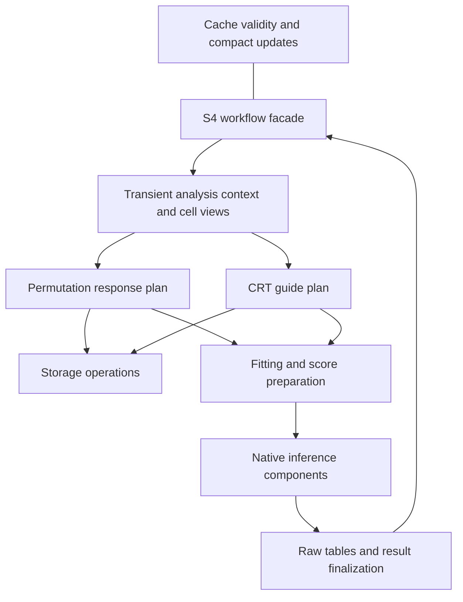

# Internal architecture

This guide describes the internal refactor on `codex/refactor`. Acceptance
evidence and remaining gates are recorded in [the refactor status](tools/refactor/STATUS.md).
The public functions, defaults, 56-slot S4 object and saved-object representation
remain the user interface. No accelerated method, new QC rule, new backend,
backed CRT, or plugin framework is introduced by this work.

## Ownership and data flow

| Responsibility | Owner | Boundary |
| --- | --- | --- |
| Public workflow and saved state | `R/s4_analysis_functs_1.R`, `R/s4_analysis_functs_2.R`, `R/workflow_state.R` | Validate supported requests, enforce prerequisites, commit successful outputs |
| Facade to numerical inputs | `R/analysis.R`, `R/analysis_context.R` | Ordinary transient lists and explicit ordered cell/request maps |
| Sparse/backed operations | `R/storage.R` and existing native count kernels | R 1-based source columns; no statistical policy |
| QC measurements and eligibility | `R/pair_qc.R`, `src/pair_eligibility.h` | Aligned counts and the existing shared threshold predicate |
| Calibration candidate construction | `R/neg_control_functions.R`, `src/negative_control_functions.cpp` | Existing candidate stream, RNG and acceptance rule |
| Current numerical fitting | `R/fitting.R` | Response/design or treatment/design arrays to compact fits/probabilities |
| Score preparation | `R/score_preparation.R` | Ordered response/design/compact fit to `mu`, `a`, `w`, `D` |
| Cache validity and updates | `R/fit_cache.R` | Supported mutation events, keyed compact fits, facade writeback |
| Distinct association plans | `R/association_execution.R`, `R/association_workers.R` | Response traversal for permutation; guide traversal for CRT |
| Worker mechanics | `R/execution.R` | Partition dispatch, progress/logs and result binding |
| Native inference | `src/inference_scores.cpp`, `src/inference_tail.cpp`, `src/inference_stages.cpp` | Explicit arrays/draw-bank references; legacy wrapper in `src/low_level_full_test.cpp` |
| Results and finalization | `R/result_processing.R` | Native records to raw tables, failed-QC rows, guide integration and family correction |



The plans share worker mechanics, not a universal statistical inner loop.
Permutation analysis loads each response and reuses its preparation where valid.
CRT prepares shared response fits, then fits one assignment model and generates
the full draw bank once per active guide/view, reusing it across that guide's
responses. NT-control discovery retains guide-specific response fits.

## Coordinates and lifetime

`analysis_to_source` maps R analysis positions to original matrix columns.
`nt_to_analysis` retains the ordered NT-only view, which can be nonmonotone.
Canonical transient group memberships use analysis positions. Persisted legacy
NT-local assignments are normalized once by `prepare_index_context()`.

`make_fit_view()` supplies ordered source columns and local treatment/control
positions. Response extraction and design subsetting use the same view. Raw
source memberships are normalized in analysis order, preserving the old mask
semantics rather than the order of the raw vector. Request-row maps preserve
identity independently of response-sorted count scans and execution traversal.

Storage takes R 1-based source positions. The legacy Rcpp inference entrypoint
also accepts R 1-based observed treatment positions, converts them once, and
calls private components using zero-based positions. Synthetic draw banks are
already zero-based and never pass through that conversion.

Contexts, score arrays, assignment probabilities and native draw pointers are
transient. No full store copy or per-pair cell map enters the saved cache. Only
compact response coefficients/dispersion remain in its existing list. Its view
is the common analysis universe for complement controls or the NT-only
calibration universe for NT controls; guide-specific NT-discovery fits are not
persisted. Setters clear incompatible fits when assignments, analysis cells,
actual designs or control views change. The open guide-cache feature in PR 233
is deferred.

The private ondisc route is deliberate: backing pointers, identity-preserving
construction, reattachment and private kernels are confined to `storage.R`.
In-memory workflows do not need ondisc. Import-format parsers and construction
of the exported assignment matrix retain their format/output-specific sparse
construction code. Existing HDF5 and sparse native scans remain separate.

## Where to make a later change

- **Output-compatible fitter:** start in `fitting.R`, whose response fitter
  currently executes Poisson `glm.fit()` plus a clipped dispersion estimate,
  and whose assignment fitter executes logistic `glm.fit()`. Score preparation
  owns the current projection and array orientation. Use the actual fit view;
  an all-cell response fit cannot replace a treatment-plus-NT fit. A different
  fitter or effective settings will also need a concrete cache-identity change
  and scientific validation when introduced.
- **QC policy:** measurements come from `collect_pair_qc_metrics()`. The current
  threshold rule lives in `pair_eligibility.h`; the vector adapter and native
  calibration sampler call it. A replacement requiring side, family or new
  measurements must define those inputs and calibration behavior together.
  Do not change only the discovery filter or replace the candidate stream.
- **Inference method:** current score/effect arrays and the original design are
  available in the workers. Implement the selected runner there and reuse raw
  result conversion/finalization where justified. SPA or Wilcoxon need not
  generate this method's `D` or draw bank. This guide does not select their
  statistical definitions or add empty extension hooks.
- **Storage adapter:** implement the small operations in `storage.R` and test
  values, order, repeats, shapes, explicit-zero/fractional semantics and caller
  nonmutation. Counts describe requested pairs; they need not allocate a full
  Cartesian table. Keep representation branching out of statistical workers.
  Enabling backed CRT later also requires separate parity/resource validation
  and review of the existing validation guard and distributed work plan.

SCEPTRE's sparse count kernels convert coordinates once into native-owned
scratch and leave R inputs unchanged. External ondisc kernels that decrement
indices receive disposable copies at the storage boundary. Current counters
count stored sparse positions, including explicit zeros;
ondisc construction coerces fractional values to integers. Those legacy rules
are characterized rather than silently normalized.

## Results and component compatibility

`pair_results_from_native()` preserves output amounts 1/2/3 and legacy fields,
including `se_fold_change`. `assemble_pair_results()` restores failed-QC rows
and the output ordering. `integrate_guides()` and
`finalize_association_result()` take plain tables and explicit settings; neither
needs an S4 object. Finalized standard analyses integrate and correct the complete
family after collection. Nuclear pipeline shards remain raw Parquet without a
global correction or significance column.

Private pipeline names such as QC/calibration part functions and result
processors remain compatibility entrypoints. Unconsumed precomputation/table
aliases and optional worker reconstruction routes were removed after checking
package and pinned consumer callers. The lean `make_treatment_index_lookup()`
closure resolves the one canonical index; it does not retain per-guide view
banks or reconstruct missing context. No parallel obsolete algorithm is kept.
The pinned pipeline's scripts, file schemas and known limitations are listed in
[the consumer inventory](tools/refactor/consumer-inventory.json) and tested by
[the consumer harness](tools/refactor/CONSUMER_COVERAGE.md).

## Verification for contributors

Run targeted tests for the boundary being changed, then the package suite at a
coherent integration checkpoint:

```r
testthat::test_local(filter = "refactor-indexing")
devtools::check()
```

Use `SCEPTRE_REQUIRE_ONDISC=true` for required backed coverage. Run private native
component checks with `Rscript tools/refactor/test-native-components.R` from a
source checkout. [The harness guide](tools/refactor/README.md) describes frozen
fixtures, same-environment reference comparisons, pipeline checks and resource
measurement. Never regenerate expected outputs from a refactor candidate.
Use separate source trees for concurrent compilation/check/install jobs.

Preserve the supported behavior matrix and public API. Numerical or method
changes need their own review and validation; the bounded control-view cache
correctness correction is recorded explicitly in the refactor status.
