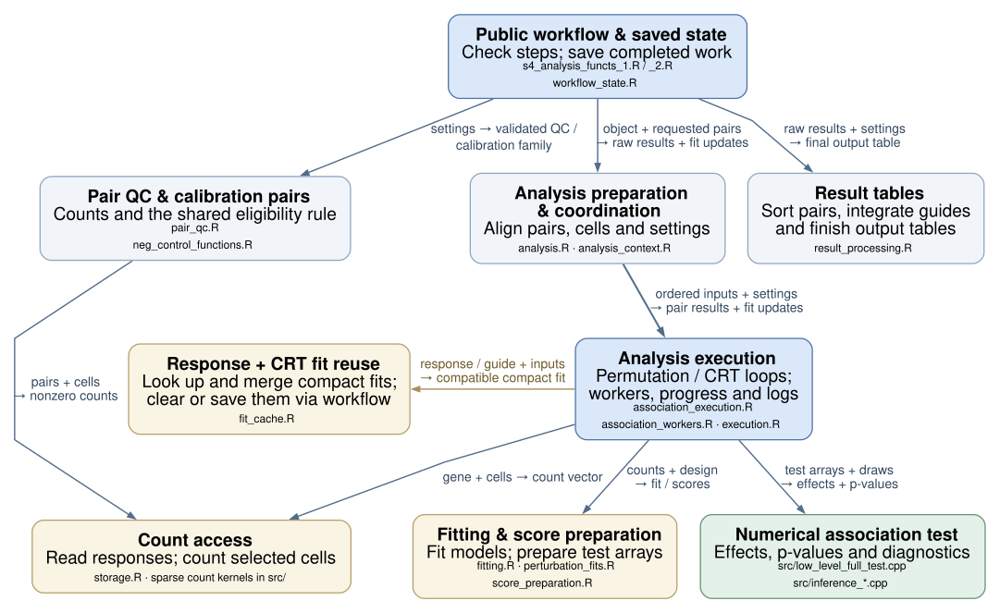

# Internal architecture

This is the permanent entrypoint for extending SCEPTRE. The public workflow
coordinates five durable S4 owners under `schema_version = 3L`; `RunPlan` and
`CellView` are small typed execution values. Statistical fitting, score algebra,
resampling, pair processing and storage operations remain ordinary functions.
There is no class per algorithm, saved execution mode or universal plugin API.

The [reflected field inventory](tools/components/schema3/OBJECT_FIELDS.md) gives
exact current slots/types. The [schema guide](tools/components/schema3/ARCHITECTURE.md),
[legacy field decisions](tools/components/schema3/FIELD_DECISIONS.md),
[RunPlan decision](tools/components/runplan/DECISION.md) and
[FitCache precedent/contract](tools/components/fits/PR233.md) supply deeper detail.
For development and checking, see [CONTRIBUTING.md](CONTRIBUTING.md).

## Owners and data flow

| Owner | Authority and lifetime |
|---|---|
| `sceptre_object` | References to `data`, `spec`, `preparation`, `fits`, `results`, plus schema version. Completion is derived, not a saved call journal or Boolean flag vector. |
| `ScreenData` | Normalized response/guide CountStores, aligned source-cell covariates, canonical guide metadata, display labels, MOI and content identity. Count-store row names are canonical IDs; `response_names` is separate annotation. |
| `AnalysisSpec` | Canonical requested hypotheses and resolved scientific choices. No sampled calibration family, realized budget, worker controls or duplicate requested-settings snapshot. |
| `PreparationRecord` | Compiled design/pairs/group labels, durable source assignments, QC selections/metrics and successful stage identities. Assignment exists before QC. |
| `FitCache` | Independent compact response and CRT perturbation model families, with actual-input identities. No cell-length predictions, scores, QR arrays or resampling banks. |
| `ResultRecord` | Completed entries owning their table, frozen choices/RunPlan, scope, input identity, history and optional invalidation reason; recognized legacy import metadata. |
| `RunPlan` / `CellView` | Transient realized family/budgets/input certificate and ordered fit mappings. The completed RunPlan is frozen in result provenance, not installed as working settings. Neither owns copied count matrices. |

Canonical pair tables in Spec contain target-response requests. Preparation
owns compiled guide-group expansions and `*_with_info` QC tables, including
failed-QC rows. Canonical guide metadata exists once; `guide_groups` is its
row-aligned derived grouping, and `guide_group_metadata()` constructs a view.
`pair_count(..., passing = FALSE)` counts canonical requested rows. Passing
Bonferroni counts response-target families with at least one eligible guide;
other strategies retain their established passing compiled-row definition.

Arrows run from requester to provider. These are responsibilities inside one
package, not separately installed modules. Permutation and CRT share worker
mechanics while retaining distinct statistical traversal and draw-sharing rules.

## Boundary contracts

The table names concrete functions and principal regression files; it is a map
for changes, not a claim that passing one test qualifies a new scientific method.

| Boundary / owner | Shape and order | Mutation, identity and resource contract | Principal tests under `tests/testthat/` |
|---|---|---|---|
| `import_data()` / ScreenData | Modalities may differ in features but share ordered source cells; covariates have one row per source cell. | Normalize to supported CountStores, acquire imported content identity, preserve canonical feature IDs independently of display labels. Supported content replacement invalidates dependents. | `test-refactor-storage.R`, `test-refactor-storage-ownership.R`, `test-run-plans.R` |
| `set_analysis_parameters()` / Spec | Canonical requests and resolved scalar scientific choices; compiled design has source-cell rows. | Validate before expensive work. Alpha is one finite numeric value in `(0,1]`; correction names retain supported `p.adjust()` aliases/unambiguous abbreviations. Generated formula AST uses `baseenv()`; user formula environments remain intact. | `test-formula-boundary.R`, `test-analysis-spec-validation.R`, `test-s4_analysis_functs_1.R` |
| `begin_preparation_stage()` / `commit_preparation_stage()` | Design → assignment → cell QC → pair QC; payloads cover their declared source/compiled scope. | Invalidate dependent stages/results locally; publish a stage identity only after successful validation. `stage_complete()` checks payload, inputs and prerequisites. | `test-refactor-state.R`, `test-s4_helpers.R`, `test-run-plans.R` |
| `make_run_plan()` / `validate_run_plan()` | Typed complete family, integer B1/B2/B3, calibration-only sizes and original certificate. | Own mutable pair tables. Structural validity and screen-context matching are separate; never re-sign changed old plans. `run_plan_payload()` preserves the ordered historical hash representation. | `test-run-plans.R`, `test-run-plan-migration.R` |
| `prepare_index_context()` / `make_fit_view()` | Ordered source → analysis → fit mappings; `trt_fit_pos` indexes the exact response/design order. | Small on-demand views; no eager per-pair full cell map or count-store copy. `make_treatment_index_lookup()` forces its captured index at construction. | `test-refactor-indexing.R`, `test-refactor-context-execution.R` |
| `storage_*()` / CountStore | R one-based source cells; requested order/repeats and declared sparse/backed count semantics. | Own buffers before native mutation. Read one complete response row before selecting its fit cells; no general out-of-core scaling promise. | `test-refactor-storage-ownership.R`, `test-refactor-vector-aggregation.R`, `test-refactor-import-coordinates.R` |
| `fit_response()` / response FitCache family | Named coefficients plus scalar dispersion, with actual ordered fitting cells/design columns/values. | Poisson `glm.fit()` then dispersion at Poisson means, not an NB refit. Response fits are admitted only for matching actual scope. | `test-refactor-context-execution.R`, `test-fit-cache-families.R` |
| `fit_perturbation_model()` / perturbation FitCache family | Binary treatment membership on actual ordered fitting design; compact coefficients/diagnostics only. | One cold fit. Finite nonaliased coefficients must reconstruct original probabilities exactly using binomial inverse link; otherwise use original probabilities and decline caching. Warnings occur on actual fits, not warm replay. | `test-perturbation-model.R`, `test-fit-cache-families.R` |
| `execute_analysis_blocks()` / workers | Ordered block replies, retaining legitimate NULL; scheduling/output controls remain transient. | Workers return proposals. Failure/lost reply stops collection; no partial public commit. Structured errors preserve block/context/cause, and interrupts escape. | `test-worker-errors.R`, `test-structured-workers.R`, `test-refactor-context-execution.R` |
| `finalize_association_result()` / result coordinator | Restore failed-QC requests, integrate guides, correct the complete family after collection. | Calibration/discovery significance is verified over the full family; power retains grouped-output semantics. Raw subsets cannot be committed as complete prepared families. | `test-refactor-results.R`, `test-run-plans.R` |
| `commit_result_record()` / `get_result()` | Final table plus complete provenance/history graph, retaining table class/order/attributes. | Admission and public extraction acquire owned snapshots. Historical extraction detaches nested tables/RunPlans too. `current_result()` is a private borrowed read-only helper. | `test-result-ownership.R`, `test-component-results.R` |
| `write_analysis_summary()` / export | Existing summary text and output files. | Scoped connection/sink cleanup on success, error and interrupt; preserve caller sinks and original failure. Export uses current-result guards. | `test-output-resources.R`, `test-result-ownership.R` |
| Backed save/reopen and migration | Descriptor metadata remains readable while closed; numerical handles reopen per process. | Anchored identity survives verified relocation; old physical layouts are adapted explicitly and unknown provenance remains historical. | `test-ondisc_paths.R`, `test-ondisc-capabilities.R`, `test-schema-migration.R`, `test-fit-cache-migration.R` |

## Lifecycle, identities and ownership

The prerequisite chain is import → design → assignment → cell QC → pair QC.
A stage record contains its input identity; completion additionally requires
matching payloads and valid prerequisites. `workflow_status(object)` derives
status from these stages and current result entries. Arbitrary direct slot or
reference mutation is not a supported state-transition API.

Preparation changes invalidate dependent stages and mark retained results with
`invalidated_by`. Failed public calls return no partially completed object.
Workers propose numerical results and cache changes; successful coordinators
finalize and validate before returning updated results/fits. Historical results
remain readable through `get_result(..., historical = TRUE)`, which warns when
the entry is not current. Currentness requires current QC, a matching complete
family/input certificate and no invalidation reason. Plots/getters/export share
this rule rather than treating a nonempty old table as current.

`owned_result_value()` in `R/owned_results.R` detaches the exposed value graph,
including data.tables reachable through historical record attributes and nested
RunPlan pairs, with a serialize/unserialize ownership boundary. It preserves
attribute order, compact row names and serialized representation because frozen
execution hashes include representation. Serialized data.table null self-references
are left intact; normal first local mutation acquires its own allocation. Eager
`alloc.col()` repair would change R 4.4 growable-vector flags and old certificates. Internal code may borrow
`current_result()` only for reading; data.table reference mutation must not be
applied to that borrowed table. Copying every internal read or the whole screen
would put the ownership cost at the wrong boundary.

Method identities and canonical analysis names live in
`R/scientific_identifiers.R`: `response_fit_method_id()`,
`perturbation_fit_method_id()` and `analysis_names()`. Method tags are persisted
certificates; changing an algorithm requires a deliberate new tag and review of
fitter, reconstruction, validation, cache/run identity, migration and provenance.
A new Spec field is not automatically included in a run identity.

The FitCache families are independently valid:

- Response fits share one actual fitting scope: content identity, ordered source
  cells, ordered design columns and selected design-value hash. Complement fits
  can use all QC cells. NT calibration uses the ordered NT cells; NT discovery
  uses treatment-plus-NT group fits that are transient, not relabeled global fits.
- Perturbation fits model CRT treatment membership, independently of guide
  assignment's mixture method. Common analysis cells/design/runtime are stored
  once; each group has compact hashes of actual fit cells/design/binary treatment
  plus coefficients/diagnostics. NT-control cell vectors are not repeated per
  group. Reconstruction uses the exact matrix-product/zero-offset/binomial
  inverse-link path; `plogis()` is not interchangeable.
- Assignment reruns clear perturbation fits at either MOI. High-MOI reassignment
  can preserve compatible response fits; low-MOI reassignment can change fitting
  cells. Changed retained cells/design invalidate the appropriate families;
  pair eligibility or reporting changes can retain fits whose actual inputs agree.
  Calibration bypasses perturbation cache lookup/writeback and preserves existing
  discovery entries. Random draws are never cached.

A RunPlan owns the realized family/budgets and binds actual input values/order.
Calibration uses its requested family size for empirical B3; discovery/power
retain the existing maximum-passing-family policy. Calibration never overwrites
working Spec budgets because no such budget slots exist. Permutations share the
full B1+B2+B3 draw bank across the run; CRT generates a full fresh bank per guide.
Preserve native generators, traversal, bank sharing and stream consumption.

## Coordinates, count semantics and resources

`analysis_cells` lists ordered original matrix columns. `analysis_to_source`
maps analysis positions to those columns; `nt_to_analysis` can be nonmonotone.
With retained source columns `c(2,4,7)`, analysis positions `c(3,1)` select counts
and design rows at source columns `c(7,2)` in exactly that order. They become fit
positions `c(1,2)`. NT-control `analysis_groups$indiv_nt_grna_idxs` indexes its
ordered `all_nt_idxs` list; complement memberships index analysis cells directly.
`CellView` makes that distinction explicit. Pair-row identity is independent of
response-sorted storage scans and execution traversal.

R storage/observed treatment indices are one-based; the checked Rcpp association
entry converts observed positions once. Synthetic banks are already zero-based.
Score arrays follow fit-cell order. `D` has one column per fit cell and one row
per eigencomponent, not original coefficient coordinates. A future test should
not manufacture this method's arrays merely to satisfy an old interface.

`CountStore` is the closed union of normalized `dgRMatrix`, `BackedCountStore`
and NULL. A backed store owns one descriptor (path, anchored checksum,
dimensions, dimnames, import ID) and an optional process-local handle. Descriptor
metadata remains available while closed; computational access needs reopening.
`ondisc` is optional, loaded only on backed paths. `R/ondisc_capabilities.R`
checks required R signatures, class/method layout and native registration before
using private APIs; it does not establish numerical parity for an arbitrary
installation. The pinned qualified source and support instructions are in README.

Saving validates the anchor and writes closed adapters, not live pointers.
Reopening verifies anchored content/axes/ID and allows relocation without
re-signing changed bytes. An import ID alone is not content identity. Active
backing files are immutable by contract; getters and per-gene loops do not scan
for unsupported external edits. Native draw pointers are transient too; neither
they nor count handles are portable worker payloads.

Keep established count semantics unless a separately qualified scientific change
is intended: current sparse QC counts stored positions, including explicit zeros;
logical sparse normalization follows its characterized stored-entry convention;
vector aggregation follows Matrix's logical values; ondisc construction coerces
fractional values to integers. Owned copies protect inputs from mutating native
kernels. Dense import preserves general shape; sparse vector aggregation uses
bounded dense column blocks rather than densifying the whole guide store. These
are concrete operation contracts, not evidence of arbitrary large-screen scale.

`execute_analysis_blocks()` signals `sceptre_worker_error` with `block`,
`analysis`, `phase`, `reason`, `cause` and `parent`; the original condition remains
inspectable rather than flattened to message text. A lost reply is distinct from
legitimate NULL. Interrupts are re-signalled, not converted to ordinary worker
failures. Early correction admission uses `sceptre_argument_error` with an
`argument` field; other validation/numerical errors retain their existing
contracts. Scoped summary output in `R/output_resources.R` restores process
output routing on every exit and leaves caller sinks intact.

## Concrete extension seams

| Change | Existing seam | Required coordinated edits |
|---|---|---|
| Response or perturbation model | `R/fitting.R`, `R/perturbation_fits.R`, `R/score_preparation.R` | Add a validated scientific choice; define compact fit/diagnostics and score/reconstruction contract; update family validators, method tag, actual-input cache/run identity and provenance. Qualify the science and cold/warm behavior independently. Preserve a compatible other fit family. |
| Statistical test | Four workers in `R/association_workers.R`, checked native entry in `src/low_level_full_test.cpp`, `R/result_processing.R` | Specify statistic/effect/uncertainty/missingness/output shape. Reuse views/storage/finalization where contracts fit; otherwise add a small concrete worker/result adapter. Regenerate Rcpp bindings for native changes. Preserve the unchanged test's draw/RNG contract and complete-family adjustment. |
| Public analysis/family | Spec → preparation → RunPlan → ResultRecord | Update canonical names/aliases, pair selection/prerequisites, family/input identity, provenance, reporting/export and migration as needed. Define the family explicitly; partial worker scope is not a completed family. |
| Count representation | CountStore normalization/validity and concentrated `storage_*()` operations | Extend the closed union/operation branches for a real backend. Preserve order/repeats/shapes, source coordinates, stored-zero conventions and ownership; define handle lifetime, save/reopen/relocation and optional dependency behavior. |
| Executor | `execute_analysis_blocks()` locally; experimental `prepare_execution()` → `execute_work_unit()` → `collect_execution()` value protocol | Preserve whole-key traversal, serializable certificates/proposals, local count/draw resources, error/NULL/lost-reply semantics, cleanup, frozen global family and single finalization. Qualify any real process transport/scheduler separately. |

A concrete second implementation may justify an explicit selection branch or
operation-level dispatch. No universal model/backend registry, class per test,
heterogeneous cache framework or scheduler is required now.

An experimental value protocol is implemented in
[`R/distributed_execution.R`](R/distributed_execution.R). `prepare_execution()`
freezes one full-family RunPlan and canonical contiguous work units, each spanning
whole response keys for permutations or whole guide-group keys for CRT. Its
owned manifest contains protocol/runtime/method/context certificates and global
row IDs; it contains no counts or live handles. Calibration groups are sampled
once during preparation. Runtime certificates include R, package/stats versions,
platform, BLAS, matrix-product option and RNG kind; deployments must additionally
pin one exact package artifact. Hashes detect accidental mismatch, not forgery.

`execute_work_unit()` receives the full matching prepared screen with live local
count stores. It reconstructs the full ordered context and native draw resources
locally, restricts execution to its whole keys and returns raw globally indexed
rows plus compact fit proposals. It performs no family integration or completion.
`collect_execution()` accepts all units in any arrival order, validates certificates,
coverage, row order/labels and fit scopes, restores canonical order and finalizes
the complete family once before committing results/cache proposals. Missing,
duplicate, corrupt or conflicting units fail atomically. Transport, scheduling,
resource reopening and deployment remain external responsibilities; live native
pointers cannot be serialized into worker payloads.

[`test-distributed-execution.R`](tests/testthat/test-distributed-execution.R)
covers direct/protocol numerical and RNG comparisons, calibration/power,
serialization/ownership, collection rejection and failure atomicity. Initial
local smoke checks pass; final protocol qualification is pending. This is not a
claim of separate-process, scheduler or Nextflow qualification.

## Saved objects, pipeline status and checking

Migration reads physical serialized attributes rather than trusting the new
registered slot list. Recognized schema 1/2 payloads/tables/history remain
readable with explicitly unknown old result provenance; unverified fits are not
re-certified. Documented earlier schema 3 list-plan/response-cache layouts have
explicit adapters preserving valid original certificates. Current schema-3
admission validates initialized working Spec correction settings before consuming
saved caches/plans; `readRDS()` alone does not invoke S4 validity. Empty prototypes
remain admissible, and historical inspection does not require fresh validity of
the entire stale preparation graph. Unknown or malformed layouts cannot gain
currentness by being re-signed. Keep original RDS files for
metadata outside the documented retention guarantee.

Pipeline adaptation is actively being developed in a separate worktree and is
**not yet qualified against the current package candidate**. The package has no
flat-slot compatibility facade, `nf_pipeline`/`nuclear` mode or saved shard scope.
Private phase signatures/intermediate formats are implementation details for
that adaptation. Earlier flat-layout pipeline/parity documents and companion
commit tables are historical evidence for their named revisions, not current
compatibility claims. A collector must assemble raw shards and perform global
family integration/adjustment once; adapting it must not constrain R ownership.

Use targeted regressions for changed boundaries, followed by integrated package
checks. [tools/checks/README.md](tools/checks/README.md) documents current-source
native/safety checks; `SCEPTRE_REQUIRE_ONDISC=true` makes backed coverage required.
Existing [schema qualification](tools/components/schema3/VALIDATION.md),
[RunPlan evidence](tools/components/runplan/validation/README.md) and
[FitCache qualification](tools/components/fits/QUALIFICATION.md) are receipts for
their recorded revisions/environments, not blanket evidence for later edits,
other operating systems, the R floor or realistic large-screen performance.
Use separate source trees for concurrent compile/install/check jobs. Numerical
method changes require their own scientific review and qualification.
