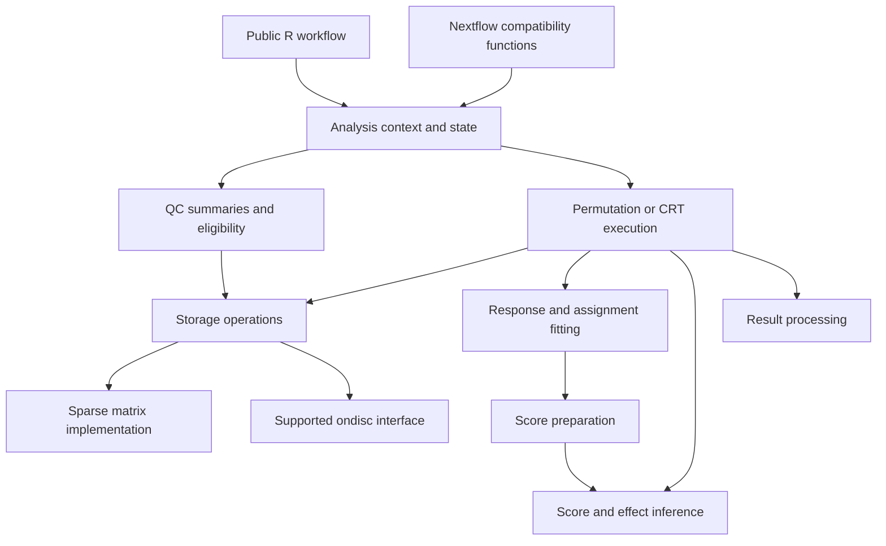

# Sceptre and ondisc refactor technical specification

Status: implemented and qualified at production checkpoint 0a9f9d8, with two
explicitly accepted bounded memory costs. Date: October 16, 2026.

See [final acceptance](tools/refactor/FINAL_ACCEPTANCE.md),
[current status](tools/refactor/STATUS.md) and the resulting
[architecture](ARCHITECTURE.md). This specification and its approved
[source cleanup addendum](tools/refactor/CLEANUP_PLAN.md) preserve the design,
reviewed exception ledger and deferred extension scope; proposal/future tense
below describes that original plan. No deferred extension became a deliverable.

The refactor adds no new functionality and preserves the current sceptre public API. It will make the existing implementation substantially cleaner: fewer duplicated operations, explicit indexing, localized state/cache management, and small statistical functions with clear inputs and outputs. Future methods and integrations should be straightforward to add at those boundaries without adding their complexity to this refactor.

The governing acceptance criterion is: existing user code and supported workflows continue to work through the same interface and produce the same results, while the implementation becomes materially easier to understand and change. Any API exception needs a concrete reason and a separately reviewed, narrowly scoped change; compatibility alone does not justify adding new public surface.

This specification proposes engineering decisions; it does not adopt new scientific defaults, assign developers, or authorize implementation of the extensions discussed below. Normative words such as “must” describe acceptance requirements for the proposed refactor.

## 1 Scope and priorities

The priorities, in order, are:

1. Add no functionality; preserve the current public API, supported behavior, and reproducibility.
2. Make the existing implementation easier to read, test, and change.
3. Localize storage, QC, fitting, inference, execution, and result responsibilities.
4. Make specific anticipated changes possible without restructuring unrelated modules.

The implementation covers sceptre internals, encapsulation of its ondisc dependency, and corresponding compatibility work in sceptre-pipeline and sceptre-book. Use existing component APIs first. The possible ondisc wrapper exports in section 6 are one specifically justified companion-interface exception for review, not automatic authorization for API expansion. R, Python, and Nextflow remain coordinated components; this work does not combine them into one package or repository.

### Included work

- Characterization fixtures and explicit compatibility contracts.
- A small internal interface for the two currently supported matrix representations.
- Ordinary functions for preparing an analysis and its treatment/control views.
- Separation of QC measurements, eligibility decisions, and negative-control sampling.
- Explicit response-fitting, assignment-fitting, and score-preparation functions.
- Centralized cache invalidation, accounting for the pending gRNA-cache PR.
- Shared execution utilities around distinct permutation and CRT traversal paths.
- Separation of score/effect calculations from resampling inference and result formatting.
- Preservation of Nextflow consumers and backed-object loading.
- Removal of obsolete internal code and misleading documentation after callers migrate.

### Deferred work

The following are independent feature or method projects: replacement pairwise QC; Fishash/Fishash+ adoption or repair of the mixture algorithm; glmGamPoi-style fitting; SPA; Wilcoxon; empirical calibration; PCs as covariates; cell-composition testing; per-pair power; supplied or weighted assignments; GPU execution; new Bioconductor storage adapters; and CRT on ondisc/Nextflow. The refactor leaves identifiable places for these changes without implementing them.

Backed-matrix CRT is an architectural compatibility check in section 13.1, not a feature deliverable or release commitment. The initial restriction is a compatibility baseline, not the intended permanent architecture. Indexing cleanup is part of the core refactor and must migrate real callers, rather than stop at documenting coordinate conventions.

Replacing the public S4 class, introducing a plugin registry, creating a general workflow engine, and designing a universal model-family hierarchy are outside this specification. No extension requires its own empty hook, placeholder implementation, or speculative field in the core.

## 2 Baselines and existing dependencies

| Component | Reference for this specification | Consequence |
| --- | --- | --- |
| sceptre | `21f9ea098b69c444a884a49bc254de711968e3b5`, version 0.99.0; local source matches current upstream main | Generate reference fixtures from this commit before moving calculations |
| ondisc | Upstream `589803edea2a66ad15e7f07186bee16c7739ab8c`; local `4d9d75e` has the same source tree | Retain the existing `.odm` representation and bounds fixes |
| sceptre-pipeline | Inspected local tracked source at `38dc760a5b4105d1c3f339cd45f2c98d971087f4`, branch `feat/nf-core-template` | Treat its R scripts and normal/nuclear paths as actual downstream consumers |
| sceptre-book | Inspected local source at `63704b0cca4b334f5b957da928ce718d38184f20` | Preserve documented workflows, repeated analyses, and the backed-matrix restriction |
| gRNA cache | Open [PR 233](https://github.com/Katsevich-Lab/sceptre/pull/233), inspected head `3f1ff0650078b382662ee70b72ea5c72fa15b031` | Resolve its integration before editing its overlapping cache/driver code |
| SPA development | Ziang's `codex/tail-fitting-study` branch, inspected head `7ea1aefd246f87965a16a1cfc5a4bf5b1901e05a` | Consult its actual fitting and inference requirements before finalizing those boundaries |
| PerturbPlan adapter review | Local `615ef7bb05a7caffa8fc0117d070510e2edba5bb`, `R/power_posthoc.R` | Its existing power API needs explicit QC, group-size, and baseline-expression interpretation |

The pipeline and book revisions are local consumer baselines, not claims about their upstream release branches. Generated untracked pipeline documentation is outside the review. Refresh all implementation baselines at the start of work; a later merge creates an explicitly recorded fixture baseline rather than silently replacing expected values.

The inspected pipeline modules pin historical sceptre 0.10.2 containers, while the R source baseline here is 0.99.0. RF0 must inventory which script/package/container combinations actually run. Keep historical-container smoke tests separate from same-version pre/post-refactor comparisons built with the selected package commits. The old image cannot exercise newly added component APIs.

### Implementation startup decisions

- Integration branch: `codex/refactor`. Parallel implementation units use separate short-lived branches and worktrees based on a recorded integration commit. Reviewed, tested milestones can subsequently be proposed to `main`.
- RF0 source baseline: `21f9ea098b69c444a884a49bc254de711968e3b5`, verified against freshly fetched `origin/main` on October 16, 2026. PR 233 remains a separate change and is excluded from this baseline; resolve its disposition before overlapping cache/driver work in RF5. A later accepted baseline change requires explicit fixture review and regeneration.
- Initial ondisc route: centralize existing operations behind a private sceptre adapter. New ondisc exports require a separately justified companion-interface exception; they are not a prerequisite for starting RF0.
- RF0 changes characterization, verification, and developer documentation only. Its review checkpoint precedes structural production-code changes. Unexecuted pipeline or resource gates remain explicitly outstanding rather than being inferred from small fixtures.

The earlier [refactor proposal](https://github.com/Katsevich-Lab/sceptre3-project-v2/blob/singularity-containers/sceptre-dev/sceptre-refactor-proposal.qmd) supplies useful background but is superseded here for scope and architecture. Its immediate object replacement, universal-driver proposal, inventory, and compliance observations must not be copied into implementation requirements.

### Important behavior established by the current code

- `sceptre_object` has 56 slots, including data, parameters, caches, workflow flags, results, and pipeline metadata. It remains the public facade.
- `perform_response_precomputation()` currently runs a Poisson `glm.fit()`, estimates dispersion from that fit, clamps dispersion to `[0.01, 1000]`, and returns the Poisson coefficients plus dispersion. Its comment describes an NB refit that the executed function does not perform. Preserve the calculation and correct the comment.
- Permutation analysis primarily iterates over responses and reuses response preparation across guide groups. CRT prepares responses where applicable, then iterates over guide groups and shares assignment fitting/resampling across responses.
- Discovery with NT-cell controls can require response fits on the treatment-plus-NT subset for each guide. That fit is not interchangeable with a response fit using all analysis cells.
- Backed matrices currently support permutations, not CRT; argument validation enforces this restriction. Section 13.1 scopes its later removal after backend parity and resource checks.
- Negative-control selection performs QC inside `sample_undercover_pairs_v2()`. Extracting only `compute_qc_metrics()` would leave a second policy implementation behind.
- Nextflow scripts call private sceptre functions, set flags and pair tables directly, prune fields, and serialize intermediate objects. Those behaviors are integration dependencies even where they are not public user APIs.

## 3 Compatibility requirements

### Scientific and numerical behavior

For supported baseline configurations, preserve:

- Guide assignment, cell selection, treatment/control membership, pair eligibility, and negative-control sampling.
- Default formulas, transformations, factor coding, side encoding, guide integration, and supported MOI/control combinations.
- Response and assignment fitting, dispersion calculations, score statistics, effect estimates, resampling laws, approximation checks, and fallback decisions.
- Multiple-testing families and adjustment, including Bonferroni integration across passing guides and the separate roles of calibration, power, and discovery analyses.
- Reference result columns, types, missingness, ordering, and diagnostic output at `output_amount` 1, 2, and 3.

Same-environment structural changes must reproduce deterministic fixture outputs exactly where arithmetic and draw order are unchanged. Across R/BLAS/compiler environments, use predeclared tolerances for fitted and floating-point quantities and exact memberships/decisions for fixed inputs, including fixed draw indices. Platform-dependent sampling or unordered-container iteration is checked against the appropriate platform baseline rather than assumed to provide one universal stream. Treat borderline decisions explicitly. Do not loosen a tolerance after a mismatch merely to make a test pass. A numerical discrepancy requires an explanation and a separate method or bug-fix decision when applicable.

Do not treat every baseline failure as desired behavior. Record known defects separately. Fixes that change outputs, handling of previously accepted inputs, or statistical defaults belong in independently described changes with their own expected outputs.

### Public interfaces and objects

Freeze the sceptre export inventory, exported S4 methods, function signatures including argument order/defaults, accepted input conventions, chaining, getters, plotting workflows, and returned/exported result schemas. No new exports, aliases, method-selection arguments, configuration knobs, input backends, output columns, or supported analysis combinations are part of the default refactor scope. Internal functions and modules can change substantially behind that interface.

RF0 records this API baseline and checks it throughout the refactor. Tests must compare the export/method inventory and public formals directly, alongside the behavior fixtures. Keeping old calls working while adding new public functionality is not sufficient to satisfy API identity.

Keep the S4 layout during the initial structural stages; existing caches may gain backward-compatible internal metadata only where a concrete need is demonstrated. PR 233 is an independent change: if it lands before the selected baseline, reorganize its existing cache; if it does not, adding that cache/slot is not required to complete this refactor. Any independently adopted slot addition needs old-object read/write tests and safe missing-slot handling. A full object migration belongs in a separate project.

For any proposed API exception, document the exact before/after surface, the concrete obstacle, why an internal adapter cannot reasonably solve it, downstream compatibility and migration effects, and its acceptance tests. Review it as a named exception or separate prerequisite PR rather than hiding it in an internal extraction. No exception to the sceptre user-facing API is currently required by this specification. The candidate companion ondisc interface change is described in section 6.

Objects saved at the fixture baseline must remain usable through the documented loading path. An RDS file containing an external pointer is not a portable storage contract. Backed objects must be reattached through `read_ondisc_backed_sceptre_object()` or its preserved replacement implementation, with the existing backing-file identity checks.

Existing argument-error behavior is characterized. Improvements to invalid-input diagnostics can be reviewed separately; the refactor must not silently reorder mismatched cells, change valid input interpretation, or turn fitting failures into successful results.

### Resource behavior

No new eager dense realization of the complete response or guide matrix. Persistent caches hold compact fit information, not fitted vectors per response/guide, full score matrices, or synthetic treatment draws. Preserve response-wise and guide-wise reuse and the ability to run on bounded worker memory.

## 4 Architecture and dependency direction

Use a few logical modules inside the existing packages. Internal records are ordinary named lists and data frames with documented fields. They are transient unless an existing serialization contract requires them.



The public facade owns S4 reads/writes and workflow transitions. Numerical functions receive explicit data and settings; they do not inspect `sceptre_object`, files, global package state, or Nextflow flags. Storage code does not decide which hypotheses are scientifically eligible. Result processing does not rerun models or draw random numbers. Execution controls scheduling and reuse, not mathematical definitions.

This is an internal organization, not a new package framework. Initially, two storage implementations and the existing inference method are sufficient.

Moving code into more files or adding wrappers alone does not establish a successful refactor. Each extraction must remove duplicated plumbing or implicit knowledge from its callers, give a responsibility one owner, and remove its superseded implementation after migration. Avoid empty extension layers, speculative configuration, and parallel old/new engines that maintainers must keep synchronized.

### Proposed source organization

Keep R source files flat, as required by the package layout. Names below are proposed destinations rather than a requirement to create every file before extracting useful code.

| Responsibility | Main current locations | Destination |
| --- | --- | --- |
| Public orchestration | `s4_analysis_functs_1.R`, `s4_analysis_functs_2.R`, `sceptre.R` | Keep public wrappers; extract internals behind them |
| State and run inputs | `s4_helpers.R`, scattered object reads | `analysis_context.R`, with a single state-transition definition |
| Storage operations | `s4_helpers.R`, `preprocessing_functions.R`, assignment/QC/import branches | `storage.R`; preserve import-specific parsing separately |
| QC policy | `pairwise_qc_functs.R`, `neg_control_functions.R`, `src/negative_control_functions.cpp` | `qc_policy.R` and a shared compiled legacy predicate |
| Model fitting | `precomputation_functions.R`, mixture routines | `model_fitting.R`; keep mixture-assignment algorithm isolated |
| Score preparation | `precomputation_functions.R` | `score_preparation.R` |
| Caches | Distributed resets and driver write-back | `cache.R` |
| Execution | `medium_level_functs_v2.R`, `association_testing_functions_v2.R` | `association_execution.R` plus small mechanism-specific workers |
| Inference | `src/low_level_full_test.cpp`, `shared_low_level_functions.*` | Small C++ score/effect/inference functions with the existing entry point retained as a wrapper |
| Results | `construct_data_frame_v2()`, grouping/processing functions | `result_processing.R` |
| Pipeline compatibility | Private functions used by `sceptre-pipeline/bin` | Explicit compatibility wrappers with a tested consumer inventory |

Move code when a responsibility is extracted and tested. Avoid a preliminary mass rename or formatting-only rewrite. Remove `_v2`/`_v3` names only after checking their callers; preserve wrappers for the pinned pipeline where needed.

## 5 Analysis context and indexing contracts

Introduce `prepare_analysis_context(object, analysis)` as an internal adapter. It validates and assembles only inputs needed for one analysis and returns an ordinary list, conceptually:

```r
list(
  response_store = get_response_matrix(object),
  index = prepare_index_context(object, selected_pairs),
  design = object@covariate_matrix,
  pairs = selected_pairs,
  analysis = analysis,
  control = control_definition,
  test_options = test_options,
  caches = available_fit_caches
)
```

This is schematic proposed code, not a new exported constructor. Execution options such as worker count, progress, and log paths are passed separately so numerical functions do not receive them. Avoid copying full stores, constructing every pair's cell vector, or persisting this context in the S4 object.

### Cell coordinates

There are three explicit coordinate systems:

1. **Source cells:** columns in the imported matrix, indexed from 1 in R.
2. **Analysis cells:** positions in the ordered `source_cells` vector after cellwise QC.
3. **Fit cells:** positions in a particular fit view, such as `c(treatment, NT)` or the NT-only calibration view.

`source_cells[k]` maps analysis position `k` to the original matrix column. Existing assignment indices are interpreted in their documented analysis/calibration view. A helper such as `prepare_pair_view(context, group_id)` constructs the ordered fit-cell map and the local treatment indices. It must not assume that original, post-QC, and pair-local indices coincide.

All R-facing storage operations use 1-based source-cell indices. Conversion to a C++ kernel's 0-based coordinates happens in its adapter exactly once. Keep the current ordering of concatenated treatment/control cells, duplicate handling, and calibration-group unions until a separately validated change is adopted.

QC summaries and cardinalities must refer to the same view as the test. Discovery with NT controls uses the targeting treatment cells and the specified NT controls. Calibration with NT controls treats an undercover group within the NT pool as treatment and the remaining NT cells as controls. Resolve NT-only coordinates through the NT-to-analysis map before mapping to source columns. Overlapping high-MOI guide groups use their union membership where the current procedure does so; summing guide sizes does not establish a union size.

### Indexing cleanup deliverables

The refactor must replace repeated manual remapping with a small set of ordinary functions in the context/indexing module. Proposed contracts are:

| Operation | Input and output | Required semantics |
| --- | --- | --- |
| Build analysis-cell map | `source_cells`, source-column count → validated ordered source positions | Range/uniqueness checks; preserve supplied analysis order; no implicit sorting |
| Normalize source membership into analysis membership | Source-cell members, analysis map → analysis positions | Preserve the current mask-based analysis-order/unique-membership behavior; do not blindly replace it with raw-order `match()` |
| Build ordered fit view | Analysis map and ordered analysis positions → source-column map and local fit positions | Preserve NT concatenation and treatment-plus-control order; reuse a view across responses when valid |
| Resolve a group's local treatment/control membership | Group membership and fit view → local positions and cardinalities | Explicit NT-to-analysis conversion, union semantics where used, and no accidental inclusion of undercover treatment in controls |
| Resolve response/group IDs | Current IDs and requested pair rows → integer indices plus request-row map | Resolve once per context/block; preserve existing public duplicate policy and original row identity |
| Adapt indices to native kernels | Validated R positions → documented native argument conventions | Convert base exactly once; retain compatibility entry points that currently accept R 1-based indices |

Use one canonical transient record, built once per analysis, conceptually:

```r
list(
  analysis_to_source = cells_in_use,
  nt_to_analysis = ordered_nt_map,
  groups_analysis = normalized_group_memberships,
  nt_groups_analysis = normalized_nt_memberships,
  pair_rows = data.frame(pair_row_id, response_idx, group_idx)
)
```

All group memberships in this record are R 1-based analysis positions. Normalize legacy NT-local membership once using the ordered `nt_to_analysis` map; leave persisted S4 assignment schemas compatible. `make_fit_view(index, group_idx, analysis, control)` then supplies the appropriate source columns and local treatment/control positions. Both response loading and design subsetting consume that same view. Repeated `which(rownames(...) == id)` or string comparisons to rediscover a pair inside worker loops are replaced by the prepared integer/request-row maps.

Do not introduce another index class hierarchy or flags that ask every caller to guess the coordinate system. New internal names crossing a view boundary should identify that view, for example `source_cells`, `nt_analysis_pos`, `trt_fit_pos`, and `response_idx`. A numerical helper receives indices in one declared view; it does not decide whether they are original, NT-local, or post-QC.

Current ordering rules are not interchangeable. `update_indiv_grna_assignments_for_nt_cells()` can concatenate NT groups into a nonmonotone NT-only view. Preserve that ordered map. The raw-source-to-analysis assignment path instead produces unique membership in analysis order through its mask operation. Each helper needs the corresponding characterization test rather than a universal sorting rule.

Build common analysis/NT maps once per run and guide-specific fit views once per active guide where possible. A treatment-plus-NT view can reference its treatment vector and the shared NT map until the active worker needs materialized fit arrays. Avoid an O(number of cells) map per pair/group stored in the context or persistent fit cache. Migration covers `update_idxs()` and NT remapping in `cellwise_qc_functs.R`, the calibration/discovery index factory, duplicated driver subsetting, `combined_idxs` in the four association workers, QC counters, response-name lookup in `load_row()`, and pipeline adapters. Storage functions receive the composed source-column vector; fitting and inference receive the corresponding local positions. Eliminate nested remapping expressions from those consumers as their stages migrate.

Keep legacy native entry points behind adapters while migrating them. New private native helpers use zero-based positions; generated synthetic indices are already zero-based and must not be decremented again. This is a per-boundary migration with fixtures, not a global search-and-replace of `+1`/`-1` expressions.

Use this illustrative structural fixture with 12 source cells and post-QC source columns `c(2, 4, 5, 8, 11)`. The raw target group is `c(5, 4)` in deliberately reversed source order; NT groups, in order, are A = `8` and B = `c(2, 11)`.

| Mapping or quantity | Expected result |
| --- | --- |
| Target membership after QC | Analysis positions `c(2, 3)`, preserving analysis order |
| Ordered NT-to-analysis map | `c(4, 1, 5)` |
| NT-only source columns | `c(8, 2, 11)` |
| Discovery treatment-plus-NT source columns | `c(4, 5, 8, 2, 11)` |
| Discovery treatment positions within fit | `c(1, 2)` |
| Undercover NT-B treatment within NT-only fit | Local positions `c(2, 3)` |
| Undercover NT-B control | Source cell `8` |

With one response expressed at source cells 4, 8, and 11, discovery has one nonzero treatment and two nonzero controls; NT-B calibration has one of each. Assert the maps, extracted response/design rows, counts, native indices, scores, and restored pair identities. Repeated calls must leave caller-owned inputs unchanged. This catches raw-order `match()` substitutions, sorting of the NT view, source/local confusion, and double base conversion; it is not a scientific dataset.

Preserve dimensions for one-row/one-column cases. Validate mappings once per context or block rather than repeatedly searching IDs in inner pair loops. Resolve response IDs to indices without changing result ordering. Do not impose a new global cell-name requirement: ondisc currently does not provide full column-name semantics.

### Workflow state

Retain `functs_called` and `last_function_called` as the public object's representation. Replace duplicated knowledge of function order with one static transition/prerequisite table used by wrappers, printing, and compatibility code. Calibration, power, and discovery remain sibling analyses after QC; their execution must not imply that the others ran.

Internal computation returns results and cache updates. The facade commits them only after successful completion. No general DAG scheduler or additional stored workflow state is introduced.

## 6 Storage and the ondisc boundary

### Internal sceptre operations

Use a short set of functions backed by the existing efficient kernels:

```r
storage_read_response(store, response_idx, source_cells)
storage_threshold_row(store, feature_idx, threshold)
storage_pair_counts(store, pair_index, groups, source_cells, controls)
storage_group_counts(store, response_idxs, groups, source_cells)
```

`storage_read_response()` returns one numeric/integer response vector in the requested cell order. `storage_threshold_row()` returns source-cell positions meeting the existing assignment threshold. `storage_pair_counts()` returns counts for requested pairs in request order. `storage_group_counts()` provides the existing negative-control summary operation in bounded batches or the legacy matrix representation when that representation is actually needed.

`pair_index` identifies requested response/group combinations rather than requiring a complete Cartesian product. `groups` contains indices relative to the explicitly supplied analysis view. `controls` is either a shared control-index vector in that view or the existing complement rule. The adapter resolves this to source coordinates. Output shapes, empty results, integer types, and order are specified in the corresponding tests.

Wrappers must not mutate caller-owned indices or assignments. The current group-count kernels decrement input vectors in place, so their adapters must provide owned disposable vectors when converting coordinates. Pair counters use response-sorted scans internally; sort with a request-row map and restore exact request order, including repeated requests. Group-count matrices are groups by requested responses. Complement controls are defined relative to the supplied analysis universe, not automatically every column of the file.

Reference count fixtures use nonnegative integer counts without explicitly stored sparse zeros. Characterize accepted fractional inputs and explicit zeros separately: current nonzero counters use stored positions, and the ondisc writer coerces values to integers. Preserve those existing behaviors during extraction; normalization or stricter validation is a separate correction. Future adapters must define expression/nonzero semantics explicitly rather than inherit “stored entry equals expressed” silently.

These function names are internal and can be adjusted while implementing the same contracts. Keep the set small. A fused implementation may compute pair counts and negative-control summaries in one scan when that preserves current efficiency. Do not force two separate scans merely to match a conceptual diagram.

All new matrix representation branches and direct sparse-slot access used by these operations live in `storage.R` or its native kernels. Parser-specific imports may retain format-specific code. Statistical functions and drivers must stop accessing `@j`, `@p`, `@x`, `@h5_file`, and `@ptr` themselves.

### Ondisc encapsulation and proposed interface exception

First encapsulate existing calls in the internal sceptre storage adapter. Existing public `[,]`, `dim()`, and `rownames()` remain usable where sufficient. Do not expose new sceptre functions to users to accomplish this cleanup.

One proposed companion-interface exception is a minimal set of exported ondisc wrappers accepting an `odm` object and validated indices, covering existing thresholding, requested-pair counts, group nonzero summaries, backing identity/reattachment information, and identity-preserving construction. The specific reason is to remove sceptre's dependency on ondisc's raw pointer/layout and private symbols. These expose already implemented operations for component use; they do not add statistical functionality or change sceptre's API. Their exact surface and the alternative of retaining a centralized private adapter require review before choosing this exception.

`write_matrices_to_disk()` currently calls the private constructor twice with a shared `integer_id`. Replacing those calls with the existing public constructor, which supplies ID zero internally, would break reattachment checks. If the wrapper exception is selected, it must include an additive constructor argument or a small paired-construction operation preserving the import bundle's shared ID, metadata, and current ID-generation/RNG behavior. Otherwise preserve that operation behind the internal adapter.

Prefer wrappers around existing batched C++ kernels initially. Keep HDF5 and pointer ownership in ondisc. Define groups as cell-index sets and shared/complement controls at this boundary; scientific labels such as “negative control” and the decision to use a group remain sceptre's responsibility. Do not move working native loops into slow per-cell R callbacks.

If the exception is accepted, select final names and the minimum released ondisc version in its separate PR; release it before switching sceptre callers. The resulting target is zero `ondisc:::` calls in sceptre production code. If it is not selected, all necessary private calls/raw slot access stay confined to the single storage adapter with pinned compatibility tests; eliminating them is not a reason to expand the API implicitly or block the rest of the refactor. Ondisc remains optional for in-memory workflows in either case.

Keep `.odm` layout, public constructors, row access, and existing files compatible. No mandatory conversion to another backing format. Reopened files must rebuild process-local pointers and reject mismatched backing identities. Never serialize native/HDF5 handles as portable worker state.

### Duplication and performance

Review the copied `set_matrix_accessibility()` implementations together. Give conversion semantics one owner where that reduces maintenance without making in-memory sceptre depend on ondisc. A small package-local conversion helper may remain in both packages if the alternative creates an inappropriate dependency; specify equivalence tests and document that choice rather than inventing a third utility package.

Sharing semantic contracts does not require sharing one binary implementation across packages. Sparse and HDF5 kernels can remain separate when data access differs; their count outputs must agree on the same data. Preserve sparse scans and batching, and benchmark changes to file-open lifetime or block size separately from structural extraction.

## 7 QC policy and calibration sampling

### Separate the responsibilities

Use three stages:

1. `collect_pair_qc_metrics()` obtains the existing observed counts and any inexpensive already-available group sizes from storage operations.
2. `evaluate_pair_eligibility(metrics, qc_options)` applies the current rule and returns a mask aligned to pair identifiers.
3. Analysis executes eligible pairs and retains ineligible pairs with the existing missing result fields.

Initially the rule remains `n_nonzero_trt >= threshold_trt && n_nonzero_cntrl >= threshold_control`, with existing defaults. No new public QC-method argument is required. Keep observed counts available even when a future policy stops using them as a gate. Add metrics only when their computation and interpretation are defined; avoid automatically scanning for many hypothetical statistics.

Treatment/control cardinalities are inexpensive membership summaries with a concrete upcoming use. Define them from the exact pair view in section 5, including NT-only calibration and overlapping groups; do not estimate them from nonzero rates. They need not become new public result columns or be repeated in persistent per-pair caches.

Separate optional power/sparsity screening from structural requirements of a fit or statistic. Turning off optional thresholds does not authorize invalid indexing or numerical operations. Preserve current failures/guards for the baseline; changes in degenerate-case handling require explicit tests and, where observable, a separately described correction.

### Negative-control selection

Move the legacy threshold predicate into a small compiled helper used both by the vector eligibility operation and `sample_undercover_pairs_v2()`. Its R wrapper is the ordinary eligibility function; no per-candidate R callback is added to the native sampling loop. The sampler continues to generate candidate groups/pairs and stop at the requested number according to the existing algorithm.

Preserve candidate order, acceptance decisions, stopping, sampled identities, group-union logic, and RNG consumption. Sampling a new prefiltered table instead of checking the same candidate stream is not automatically equivalent. The existing pass-rate heuristic that determines candidate-group counts must continue to use the corresponding policy result.

This makes the future policy change a coordinated edit of eligibility and calibration sampling rather than an unnoticed discovery-only change. Storage kernels continue to return measurements and never embed the threshold decision.

### The replacement remains a method project

[Issue 225](https://github.com/Katsevich-Lab/sceptre/issues/225) owns direction-specific QC and its validity analysis. The 2024 Poisson/pilot-power work and July 2026 margin/testability report are candidate research inputs. The July report's Fisher/hypergeometric bound is a proxy for sceptre's actual covariate-adjusted statistic; this specification does not treat its independence or error-control claims as established for every control/resampling design.

The future method may require side, MOI, group sizes, expression summaries, or an intended power target. Ordinary QC functions can gain those concrete inputs when the method is selected. It must also define the selected multiplicity family and apply compatible rules to discovery, positive controls, and calibration candidates. A QC change does not by itself resolve Replogle miscalibration.

For a future family-dependent QC rule, resolve its family, alpha, and thresholds before sharding that family. Changes to correction method, alpha, candidate hypotheses, or guide integration must recompute dependent eligibility, calibration selection, budgets, and results while allowing valid fits to remain cached. This is a requirement for adopting that method; it does not silently redefine a legacy nuclear pod's current budget or add global adjustment to its raw output.

## 8 Fitting and score preparation

Separate functions with these current contracts:

```r
fit_response_current(y, design)       # list(fitted_coefs, theta)
fit_assignment_current(trt_idxs, design) # existing binomial fit information
prepare_score_current(y, design, fit) # list(mu, a, w, D)
```

The response function wraps the executed Poisson/dispersion calculation described in section 2. Preserve `glm.fit()` arguments, clipping, NA/rank-deficiency checks, and relevant warnings. The assignment function preserves logistic fitting and the exact reconstruction of fitted probabilities required by PR 233. Coefficients plus dispersion are compact persistent outputs; fitted vectors and score arrays are ephemeral preparation outputs.

Keep assignment-model fitting for CRT distinct from mixture-based guide assignment. They answer different questions and have different inputs. Do not combine them merely because both concern gRNAs.

The scalar signatures describe the baseline calculations, not a restriction on future fitting granularity. Ziang's accelerated response route requires bounded response batches sharing the same fit view; his assignment fitter can prepare a common design once per worker. Permit those extension-owned helpers to return compact fits in requested response order. Existing storage reads can initially materialize a bounded response block; no unused batching framework or mandatory new storage primitive is needed now. The full matrix must remain out of scope for eager materialization.

The score-preparation function owns the current weights, working residuals, design projection, eigen decomposition, and array orientation. Document dimensions: `y`, `mu`, `a`, and `w` have one entry per fit cell; `D` has one column per fit cell and one row per design coefficient. Use the current arithmetic order and decomposition during extraction.

Keep the actual fit-view design and assignment-law information accessible to the worker through explicit arguments. Existing SPA development needs the original `Z`, plus fitted assignment probabilities for CRT or the fixed treatment count for permutations; these cannot generally be reconstructed from `D`. Align all of them with the same ordered fit-cell view. Do not copy the design/probabilities into every pair record or persistent cache simply to make them available to inference.

Complement analyses can reuse response fits on a common analysis view. NT-control discovery fits on a guide-specific treatment-plus-control view and cannot reuse an all-cell fit without proof. Response counts may be loaded once per response block for permutations; the execution path decides reuse, and the fitting functions do not know about scheduling.

A later accelerated fitter must return the quantities actually needed by the selected statistic, with documented link, dispersion, and coefficient conventions. It is not sufficient for it to return an object called an NB fit. Any change from the current coefficients or dispersion is a numerical/method change with separate calibration, power, and effect-estimation checks.

## 9 Cache ownership and invalidation

Create a single cache module with named invalidation events and explicit cache-update merging. Reorganize caches present in the selected baseline without adding a new caching capability as a refactor requirement. Account for PR 233's compact assignment cache if independently accepted; do not recreate a competing slot/schema or treat the open feature PR as automatically included.

| Input/event | Response fits | Assignment fits | Derived QC/results |
| --- | --- | --- | --- |
| New response values through a supported internal mutation path | Invalidate affected response fits, or all if identity is unknown | May reuse if assignments/design/view are unchanged | Recompute affected quantities |
| Changed guide assignments | Invalidate when fit-cell/control views change | Invalidate | Recompute groups, metrics, and affected results |
| Changed analysis cells or their order | Invalidate | Invalidate | Recompute |
| Changed actual design matrix, including covariate values or contrasts | Invalidate | Invalidate | Recompute relevant results |
| Changed fitter, response model/transform, or effective fitting options in a later method | Invalidate affected response fits | Invalidate affected assignment fits | Recompute affected preparation/results |
| Changed response/group pair list only | Reuse still-valid fits | Reuse still-valid fits | Recompute pair metrics and result family |
| Changed side or resampling budget only | Reuse still-valid fits | Reuse still-valid fits | Recompute inference/results |
| Changed alpha, correction method, candidate family, or guide integration | Reuse only fits whose actual views remain valid | Same | Recompute any dependent eligibility, calibration selection, budgets, integration, and results |
| Changed pairwise threshold with identical cell set | Reuse still-valid fits | Reuse still-valid fits | Recompute eligibility, calibration selection, and results |
| Reattach unchanged verified backing files | Reuse only cache entries with a valid fitting context | Same | Preserve only validated state |

These are dependency rules, not a promise to maximize reuse in the first PR. Conservative invalidation is acceptable; stale reuse is not. Start by centralizing current resets, then add missing invalidation tests before making reuse more selective. Compare actual before/after designs where a supported operation can change them, rather than comparing only formula text.

Each cache lookup is scoped to the response/group and its actual fit-cell view. PR 233's `c(treatment, NT)` versus all-cell distinction must remain. Metadata shared by a cache must not be duplicated as an O(number of cells) record for every fit. No full-matrix hashing, persisted general dependency graph, new cache service, or extra cache package is required.

When an alternative fitter is introduced, fit identity also includes its implementation and effective settings. Identical response IDs, cells, and design are insufficient to reuse coefficients from another fitter. Conservatively clearing the affected cache is sufficient; entries without the required method identity are refitted. No speculative fitter metadata must be added before alternatives exist.

Older entries without enough context are conservatively discarded/refit where validity cannot be established. Supported setters and reattachment functions own invalidation; arbitrary mutation of S4 slots or externally editing backing files is not a supported cache-coherency API.

Keep synthetic treatment sets and fitted vectors out of persistent caches. Generate draws according to the current call path on each analysis. Calibration groups are constructed for that analysis; they must not reuse a discovery assignment fit merely because a textual label coincides. Preserve PR 233's separation of calibration and discovery cache use and its warning-on-fit behavior if adopted.

## 10 Inference and random number behavior

### Native boundaries

Keep `run_low_level_test_full_v4()` as a compatibility wrapper while extracting ordinary native functions for:

1. Effect estimation from `y`, `mu`, and treatment indices.
2. Observed-score calculation from `a`, `w`, `D`, and treatment indices.
3. Null-score calculation for a specified segment of synthetic draws.
4. The existing staged empirical/skew-normal p-value procedure.
5. Construction of the current return record.

The internal result remains compatible with `p`, `z_orig`, `fc`, `se`, `stage`, `sn_params`, and the optional returned null-statistic vector. Public result formatting belongs in R result processing, not in new method-specific native code.

Keep the scientific axes distinct: permutation versus CRT defines the null-generation mechanism; empirical versus skew-normal defines tail evaluation; side defines the tested tail; a future Wilcoxon procedure is a different test. Do not force all of these into one overloaded `method` enum during the refactor.

SPA is not merely a replacement for fitting a skew-normal curve to sampled statistics. Its inference runner may consume the fit-view design, assignment probabilities, score quantities, and a particular studentizer directly. The legacy route retains its eager preparation and draw order, but future runners may own different expensive preparation and explicit empirical-fallback decisions. Any worker-local native preparation has a bounded lifetime/release path and never enters S4/RDS cache updates. No common runner may make `D` or a synthetic-draw bank an unavoidable prerequisite for all future inference methods.

### Staged procedure

Preserve the stage-1 threshold `p <= 0.02`, stage offsets, `B1/B2/B3`, empirical p-value convention, skew-normal fit checks, and fallback decisions. Stage-2 and stage-3 samples are segments of the generated draws, not automatically a pooled distribution. When `B3 == 0`, preserve the existing fallback behavior rather than substituting a new draw or concatenating earlier stages. `output_amount = 3` returns the distribution used by the current path, not a newly defined aggregate.

Default budgets are set by existing parameter/QC/calibration code and can depend on the multiplicity calculation. Preserve those calculations and their timing. Do not hardcode one budget for all fixtures or replace a scientifically selected budget with a cheaper test setting in production.

### RNG contract

The baseline C++ samplers initialize Boost MT19937 with seed 4; negative-control combination/pair sampling uses `std::mt19937(4)`. Preserve the generator families, distribution implementations, initialization, draw ordering, and reuse scopes. Do not switch to R's generator, `std::binomial_distribution`, independent worker streams, or lazy generation as part of extraction.

In particular, `crt_index_sampler_fast()` depends on the full requested `B = B1 + B2 + B3`. Generating three smaller batches can produce a different sequence. Fixture export must materialize the full baseline call before taking any diagnostic prefix. Existing R-side stochastic paths and effects on `.Random.seed` also need characterization; do not normalize them silently.

Exact equality under one pinned toolchain does not imply identical unordered-set iteration or floating-point behavior across all platforms. Export explicit sampled indices and environment information for Python comparisons. Redesigning user-controlled seeding and independent streams is a separate public reproducibility decision.

## 11 Execution and result processing

### Shared utilities and distinct work plans

Extract ordinary utilities for partitioning, serial/fork execution, progress/logging, collecting worker outputs, and merging compact fit-cache updates. A work item is a response block or a guide block; do not schedule one R task per pair.

Keep two concrete plans:

- **Permutation plan:** traverse responses, prepare reusable response quantities where valid, test that response against its requested groups, and preserve shared permutation-index use.
- **CRT plan:** prepare shared response fits where valid, traverse guide groups, fit or retrieve one assignment model for the correct view, generate its synthetic indices, and reuse them across requested responses.

Retain guide-specific response preparation for NT controls. Share mechanics without replacing the plans with a universal flag-driven inner loop. Existing serial, fork-parallel, and Windows behavior remains characterized; this project does not add Windows multiprocessing or change the parallel framework.

The result of execution is an ordinary list containing raw pair results and compact cache updates. Workers do not mutate the parent S4 object. Preserve current row identity and the output sort after assembly; avoid introducing nondeterminism through worker-completion order.

### Result processing

One result module owns native-to-table conversion, output-amount fields, reinsertion of QC failures, guide integration, sorting, multiplicity correction, and significance flags. These are separate small functions, not one large generic formatter.

Keep current names and meanings, including the legacy `se_fold_change` field, until independently reviewed. Preserve factor/character conversion in pipeline artifacts where consumers rely on it. Keep failed-QC rows and their NA behavior; do not infer that an absent row means “not significant.”

Where a workflow produces a finalized analysis, shard execution returns unadjusted pair-level output and finalization uses the scientifically defined family after collecting its shards. Preserve the existing guide-integration order and perform cross-guide correction at the level required by that strategy. Never apply BH independently inside a pod and treat the concatenated significance flags as global results. Existing shard-local derived fields must be overwritten/recomputed at finalization where necessary, with compatibility fixtures guarding the final output. The current nuclear raw-shard workflow is a distinct artifact contract, described in section 12; it does not acquire a new finalization stage in this refactor.

Future empirical calibration belongs between raw association output and final multiplicity correction, under a separately selected method. Future power output is an explicit enrichment keyed by response and group/target identifiers. Neither requires model fitting to depend on plotting or export code, and neither needs an empty extension callback now.

Such an extension must specify whether it operates on guide-level or target-level hypotheses and whether it runs before or after integration. Bonferroni finalization currently retains the minimum-p guide's counts/effect and discards constituent guide rows. Those winning-guide summaries are not sufficient inputs for target-level power or a newly defined calibration procedure. Keep the raw table and original membership accessible transiently until the selected extension operation completes; no persistent duplicate result table is required.

## 12 Nextflow and component compatibility

### Preserve actual consumers

Before moving a private function, inventory references in the pinned pipeline's `bin/*.R` and both standard/nuclear modules. Required cases include parameter setting, assignment preparation/combination, QC parts, negative-control preparation, association pods, nuclear trans association, result combination, and plotting/export.

Keep thin internal compatibility wrappers for currently used functions such as `run_calibration_check_pt_1/pt_2`, `run_qc_pt_1/pt_2`, result processors, and pipeline helpers while migrating consumers. These preserve the known component interface for a bounded compatibility period, not every historical private function forever. Do not promote these helpers to public sceptre exports as part of cleanup; any later public component API needs its own concrete rationale and exception review.

Internal execution receives explicit run settings rather than spreading new `nf_pipeline`/`nuclear` checks into statistical functions. Existing flags remain in the facade for serialized object and script compatibility. Pruned pipeline objects must be accepted for the stages they actually support; do not require deleted import data or design matrices after their final use.

### Supported features and artifacts

The initial compatibility matrix is:

| Execution | Sparse in-memory | ondisc | CRT |
| --- | --- | --- | --- |
| R serial | Preserve supported permutation and CRT combinations | Preserve permutations | Preserve sparse-matrix CRT only |
| R fork parallel | Preserve currently supported combinations | Preserve existing permutation path | No new supported backend |
| Nextflow standard/nuclear | Follow existing pipeline data preparation | Preserve permutation workflows | Deferred |

This table describes the initial refactor release only. The backed-CRT check in section 13.1 identifies how the matrix could expand later without requiring another architectural refactor.

R and Nextflow comparisons must select the same supported mechanism, cells, control definition, formula, assignments, pairs, and QC settings. Comparing the R high-MOI default CRT to pipeline permutations is not a refactor-equivalence test.

Preserve current CLI arguments, file names, RDS schemas, pair/pod metadata, and the nuclear Parquet path during migration. Stage backing files before workers reopen them. Validate available identity, dimensions, and feature metadata; preserve cell order by construction through the supplied maps. Legacy `.odm` files do not store cell barcodes, so their shared integer ID cannot independently prove barcode order or distinguish modalities within an import bundle. Do not add mandatory manifests, full-file hashes, or conversion to claim otherwise. Do not pass external pointers between processes through serialized messages.

Distinguish the two output modes. Standard Nextflow combines pod results, integrates guides, and applies complete-family correction. Nuclear/trans mode currently sets correction to `none`, removes the `significant` field, and publishes raw per-pod Parquet artifacts without a global combine stage. Preserve those raw artifacts; a global nuclear finalizer is a separate enhancement. Its resource contract is pod-local: count only the current response block and avoid allocating the full NT-summary matrix just to construct a complete context.

The current result-combination script deliberately writes `NULL` instead of a final discovery object. Preserve that behavior for compatibility and record it as a separate pipeline usability limitation; this refactor does not claim to make final plotting objects available where they were not before.

RF0 also records existing nuclear-script limitations: threshold arguments are assembled but not passed to `run_qc_pt_2()`, and `arrow::write_parquet()` is called even when the selected filename has an `.rds` suffix. Give these independent bug-fix dispositions. Do not claim the corresponding options work or silently correct their semantics in a structural PR.

### Release sequence

1. Choose the ondisc encapsulation route. If the companion-interface exception is accepted, ship its additive wrappers with tests and a maintainer-selected minimum version; otherwise preserve the existing operations behind the private adapter.
2. Release sceptre internals using that route while retaining its identical public API and the pinned pipeline compatibility functions.
3. Update the pipeline scripts/container pins together with their compatibility tests.
4. Remove obsolete internal routes only after the supported pipeline version has migrated.

Do not require simultaneous deployment of unmerged branches to keep existing users working. Maintain a small tested version matrix and record pinned versions in the release notes. Bioconductor review fixes and scientific method changes remain separately reviewable; the refactor does not reopen the current submission strategy.

## 13 How anticipated extensions fit

The following are design checks and subsequent work items, not initial implementation requirements.

| Extension | Reused boundary | Work that remains with the extension |
| --- | --- | --- |
| New pairwise QC | Metrics, eligibility, and calibration acceptance | Select rule; prove/assess conditional error behavior; define side/controls/family; validate across MOI |
| Accelerated response/assignment regression | Current fitting functions and score preparation | Establish coefficient/link/dispersion semantics, bounded same-view batches, worker-local design reuse, fitter-specific cache validity, numerical differences, and failure/resource behavior |
| SPA | Score quantities, actual fit-view design, assignment law, and a distinct inference function | Account for studentization, explicit/lazy fallback, native resource lifetime, and effect/diagnostic conversion; synthetic draws and `D` must not be unavoidable prerequisites |
| Wilcoxon | Validated association inputs, cell/group views, storage, execution utilities, and results | Define ranks/ties, sidedness, controls, effect output, and calibration; bypass response-GLM/NB preparation, while a chosen CRT null may still need assignment fitting |
| Bioconductor input structures | Import adapter and storage operations | Select assay and metadata mapping; preserve sparse/delayed access; test labels/order; define supported backends explicitly |
| CRT on backed matrices and Nextflow | Source/fit-view maps, storage reads, guide-wise CRT workers, and compact fits | Migrate the three CSR read sites, validate memory/I/O and sparse equivalence, then enable R and separately migrate distributed work plans; see section 13.1 |
| Cell-composition outcomes | Association inputs, group views, fitting/inference boundaries, results | Define response/model and effect scale, donor dependence and compositional interpretation; no presumption that expression NB scores apply |
| Per-pair post-hoc power | Compact fit summaries, membership, metrics, and keyed result enrichment | Use an extension-owned adapter with explicit hypothetical effects, baseline-expression assumptions, control view, cutoff, integration, and QC interpretation; support only justified configurations |
| Supplied/Fishash/weighted assignments | Assignment output normalization and downstream group preparation | Validate assignments; distinguish binary membership, probability, and dose; adapt statistical model when these differ |
| Empirical calibration and discovery-gene-restricted calibration | Raw result processing and explicit calibration-pair scope | Define comparable controls and estimator; preserve raw p-values; validate mixed-null FDR and update caches/sampling as needed |
| GPU or a different language implementation | Semantic contracts and portable reference fixtures | Choose execution kernels and RNG/numerical conventions; benchmark; establish the level of equivalence actually achieved |

There is no requirement to express all future methods as one interchangeable object. For example, a future Wilcoxon runner can share input preparation and finalization while owning its own test path. A cell-composition method can own an outcome-specific preparation function. New method-specific result fields must be designed when those methods are implemented rather than filled with misleading count-model effects.

The inspected PerturbPlan post-hoc API multiplies rejection probability by survival under the legacy QC and sums guide cell counts. A future adapter must reconcile a replacement QC policy and overlapping high-MOI memberships rather than reuse those quantities blindly. Compact sceptre coefficients alone do not establish the baseline mean/size or a valid covariate-adjusted power calculation. Construct needed summaries ephemerally under the selected formula and expose unsupported cases explicitly.

For a rank-based test, ranks can depend on the treatment-plus-NT fit view; reusing all-cell ranks is not automatically equivalent. For cell composition, shared execution must not automatically trigger expression QC, library-size transformations, or NB preparation. Donor dependence, denominators, effect scales, and resampling laws belong to that method's specification.

Before accepting these interfaces, perform short implementation-planning walkthroughs for accelerated fitting/SPA, Wilcoxon, replacement QC, and storage/pipeline changes. Each walkthrough identifies required inputs, changes to existing modules, and any unnecessary coupling. Add only the changes supported by a concrete pain point.

### 13.1 Backed CRT architectural compatibility check

The refactor must make future ondisc-backed CRT a localized extension. It does not enable that extension, relax its validation guard, add a new pipeline mode, or require a backed-CRT implementation to finish the refactor.

The source walkthrough found that the current CRT algorithm already consumes one ordinary response vector at a time. Its immediate storage coupling is concentrated in three CSR reads: the response prepass in `run_crt_in_memory_v2()`, `crt_glm_factored_out()`, and `discovery_ntcells_crt()`. Routing those through `storage_read_response()` belongs to the existing RF3 storage cleanup. Removing the guard and qualifying additional supported combinations belongs to a later feature change.

The architectural requirements are limited to existing refactor responsibilities:

- RF1's maps must describe all-cell, NT-only calibration, and guide-specific treatment-plus-NT views without assuming sparse storage. Response loading and design subsetting consume the same ordered view.
- RF5/RF6 must preserve one assignment fit and full-B draw bank per guide/view, reused across its requested responses, including CRT's variable synthetic treatment counts. Storage must not choose the null mechanism.
- Storage adapters and transient worker resources must reopen correctly in their destination process, with no serialized native handles or eager realization of the complete matrix.
- Pipeline adapters must keep execution partitioning separate from statistical kernels. A future CRT work plan can then retain complete guide/design context without restructuring fitting or inference again.

The future feature would principally add sparse/backed parity and resource tests, relax the guard for qualified cases, and update supported settings/documentation. R and Nextflow enablement can be reviewed separately. Existing response pods repeat assignment work for guides split across pods; a later guide-oriented plan could improve reuse. Nuclear/trans still needs its own bounded pair/artifact semantics rather than a globally materialized all-pairs table. None of that scheduling work is required now.

Two residual scaling costs are worth recording without designing their solutions into the core. Guide-wise CRT can reread HDF5 response rows across guides, and disk backing does not remove the synthetic draw bank: its expected index payload is approximately `sizeof(int) * B * sum(pi)`, before capacity/metadata, score arrays, sampler workspace, and worker concurrency. Bounded I/O buffering, a different bank representation, or SPA-first inference can be considered later under their own numerical/resource contracts. SPA and accelerated fitting must not become dependencies of backed CRT merely to make the architecture appear extensible.

The design check passes when an engineer can identify the three storage reads, construct every current CRT fit view through the shared maps, and reuse the existing fitter/inference path without touching its mathematical kernels. Actual backed execution performance and numerical parity remain tests for that future feature, not claims established by this source walkthrough.

## 14 Fixtures and verification

### Reference artifacts

RF0 also freezes the [maintainability scorecard](tools/refactor/MAINTAINABILITY.md): fixed change-locality exercises, reviewed responsibility/duplication sites, per-function complexity and a fixed core-operation testability inventory. Keep R and handwritten C++ analyzer definitions separate and pin their versions. Unmeasured human exercises or unavailable metrics remain explicit gaps. There is no composite score or requirement that every metric decrease at each stage; completed stages must improve their targeted responsibility and explain temporary costs.

Add a small versioned fixture set under `tests/testthat/fixtures/refactor/` and a deliberate regeneration script outside normal test execution. Include input counts and metadata, explicit parameters, selected cell/group indices, expected metrics and results, compact fits, representative native outputs, and a manifest with source commits, R/dependency versions, BLAS/compiler/platform, RNG conventions, and comparison tolerances.

Keep detailed RDS fixtures for R tests and portable TSV/Matrix Market or similarly simple exports for Python consumption. Native pointers are materialized into ordinary index arrays for reference purposes, never serialized as fixtures. Mark whether indices are R 1-based or native 0-based. Do not regenerate expected outputs during tests or automatically accept new snapshots.

### Required configuration coverage

Use a small discriminating set rather than the full Cartesian product:

- Low MOI: permutations with NT controls, including the guide-specific response-fit path.
- Low MOI: permutations with complement controls.
- High MOI: CRT with complement controls, including assignment fit and shared synthetic draws.
- Low MOI: an explicitly selected supported CRT configuration to catch MOI-default assumptions.
- High MOI: permutations on sparse and ondisc representations of the same data.
- All three analysis roles, with matched negative-control construction and positive-control output.
- Union, singleton, and Bonferroni guide integration, including groups with only some guides passing QC.
- Left, right, and two-sided tests; empirical-only and skew-normal paths; stages 1/2/3 and failed-approximation fallback, including `B3 == 0` where supported.
- `output_amount` 1/2/3, no passing discovery pairs, partial QC failures, and stable ordering/NA fields.
- Repeated cis/trans analyses, changed side/pairs, changed formula/covariates, changed assignments, and changed cell views; cached versus cold execution.
- One-worker and multi-worker runs where supported; unsupported Windows parallelism remains explicitly tested.
- Cell subsets with noncontiguous original indices, one-column designs, overlapping high-MOI groups, empty rows, and responses expressed only in controls or treatment.
- NT-only multi-guide calibration views; unsorted/repeated pair requests; reordered cell requests; two calls with the same caller-owned group list; characterization of stored zeros and fractional inputs.
- Old saved objects and independently reopened `.odm` files, plus mismatched backing-file identities.

Fixtures may use smaller explicit budgets for focused native unit tests. At least one integration case must exercise normal production budget selection and each fallback behavior; do not claim coverage of a path that the chosen inputs never reach. A fallback-focused native test can use deterministic prepared arrays instead of relying on a random screen to trigger it.

### Required invariants

1. Sparse and ondisc summaries agree exactly on identical data and requested cell/group views.
2. R eligibility and native calibration acceptance use the same legacy predicate; baseline selected calibration identities and order are unchanged.
3. Cached/cold fitting and inference agree; each relevant mutation invalidates the right cache, and unrelated calibration does not corrupt discovery caches.
4. C++ extraction preserves observed scores, effect estimates, generated draw indices, stage decisions, null segments, and p-values in the pinned environment.
5. Worker/pod collection preserves pair identity and final results for the same reference work plan. Differences caused by changed sharing scopes must be investigated rather than hidden by sorting.
6. Finalized analyses correct the complete intended family after integration/collection. Nuclear raw-shard artifacts remain raw and omit significance flags.
7. Sceptre exports, exported methods, public formals/defaults, input/output conventions, and saved-object behavior match the baseline. Every actual exception has a specific rationale and separate reviewed disposition; additive API surface is still an API change.
8. In-memory analysis runs without ondisc installed. An installed supported ondisc version executes its tests rather than silently skipping them.

### CI and package checks

Extend the existing Linux/macOS/Windows matrix; do not describe Windows CI as absent. Include an explicit lane with ondisc installed and its integration tests required, and a lane for the optional-dependency-free workflow. Keep fixture-level tests on every structural PR. Run both package suites for ondisc API changes, `R CMD check`, and the appropriate Bioconductor checks on affected release candidates.

Compare check results to the same-environment baseline. New warnings/NOTEs require a documented disposition; existing environment-specific messages are not evidence of a new code regression. Coverage numbers are diagnostic, not a substitute for the invariants above or a target that rewards tests of implementation details.

For pipeline changes, run stage-level R smoke tests in a fresh process and the existing nf-test/small pipeline configuration with explicit script/package/container pins. First establish the combinations that actually run at baseline; keep their known failures separate from refactor regressions. Validate standard finalized output and nuclear raw-shard output independently. If the full Nextflow runtime or input data is unavailable, its gate remains outstanding; a mocked script test cannot establish end-to-end success.

### Runtime and memory checks

Capture cold/warm timings and peak worker RSS for a compact in-memory screen, a sparse Replogle-like screen with difficult fits, a CRT workload that benefits from sharing, and a backed permutation workload larger than the worker's practical dense-memory budget. Use identical data, BLAS/thread settings, worker counts, budgets, and cache state.

For workloads long enough to time meaningfully, use a warm-up and at least three measured repetitions. Initial proposed review budgets are no more than a 10% increase in median elapsed time and no more than the greater of 10% or 64 MiB increase in peak worker RSS. Investigate repeatable regressions and record an explicit engineering disposition; these budgets are proposed acceptance thresholds, not measured performance claims. Tiny tests are assessed for allocations/operation counts rather than unstable timing ratios.

Do not promise a speedup. Removing duplicated plumbing is sufficient value; preserve existing data access and fit reuse. Performance optimization requiring different fits, draw order, or representations is a subsequent change.

## 15 Implementation sequence and review units

Each row is a proposed issue/PR unit, with no developer assignment implied. Keep one component/reviewable behavior per PR where possible. The ordering is a dependency plan rather than a calendar commitment.

| Unit | Deliverable | Dependencies | Acceptance and reviewer focus |
| --- | --- | --- | --- |
| RF0 | Baseline manifest, exact public API inventory, script/package/container matrix, consumer inventory, fixtures and performance harness | None | Reproduce pinned source; freeze exports/methods/formals/schemas; identify existing limitations separately |
| RF1 | Concrete indexing cleanup, ordered cell/fit-view maps, analysis context and centralized state prerequisites | RF0 | Migrate real remapping callers; preserve distinct membership/view order rules; same extracted vectors/counts/scores and public behavior |
| RF2 | Ondisc encapsulation route; separately justified minimal wrapper exception if selected | RF0 | Existing operations preserved; review rationale/surface of any exports; ordering/nonmutation/count/file-identity tests |
| RF3 | Sceptre storage operations and migration of production ondisc calls into the adapter | RF1, RF2 decision; wrapper release if selected | No private ondisc calls or raw storage slots in statistical consumers; unchanged user API; backend lanes pass |
| RF4 | QC metric/policy split, shared native legacy predicate, calibration-sampler integration | RF0, RF3 | Identical masks, selected calibration identities, candidate stopping, and result families; no replacement QC |
| RF5 | Fitting/score contracts and centralized caches present in the selected baseline | RF0, RF1; independent disposition of PR 233 | Executed fits/cache behavior preserved, warm/cold equivalence, invalidation and old-object tests; no new cache feature required |
| RF6 | Shared execution utilities with separate response/guide plans | RF3, RF5 | Serial/parallel equivalence, retained sharing scopes, bounded memory and progress behavior |
| RF7 | Native score/effect/inference extraction behind compatibility entry point | RF0, RF5 | Exact native fixtures under pinned environment, preserved stages/RNG/fallback; review independent of algorithm changes |
| RF8 | Pipeline compatibility wrappers, standard result finalization and nuclear artifact preservation, coordinated consumer update | RF4, RF6, RF7 | Smoke tests and nf-test; standard global correction versus nuclear raw output; artifact/version matrix verified |
| RF9 | Remove obsolete paths, internal developer guide, updated user/component docs, final regression report | RF8 | No parallel old/new implementation maintained indefinitely; all gates below pass |

RF2 and RF5 can be planned independently after fixtures exist, but overlapping edits to drivers/cache files need one integrator. Rebase active method branches after a stable boundary lands rather than combining their algorithm changes with the structural PR. Preserve PR 233's review history and tests; acceptance, rebase, or explicit supersession should be recorded in that PR before overlapping work proceeds.

Suggested review roles are an implementation integrator, a statistical reviewer for numerical/QC/fitting changes, the ondisc maintainer for storage contracts, and a pipeline reviewer for consumer migrations. Named ownership and actual capacity belong in the live issue tracker after this specification is accepted.

### First implementation queue

1. Approve the supported behavior matrix, freeze RF0 artifacts, and decide the PR 233 integration sequence.
2. Land RF1's indexing/context extraction and choose RF2's encapsulation route, with an explicit rationale for any proposed companion API exception.
3. Use the completed extension walkthroughs to confirm the tightened boundaries before large driver/native moves. Keep backed CRT as a compatibility check and leave its validation guard unchanged during extraction.

## 16 Completion and deferred decisions

The refactor is complete when:

- The sceptre public API is identical to the baseline and no new functionality has been introduced, apart from any specific separately reviewed exception.
- Current supported scientific workflows and saved objects pass the pinned compatibility suite.
- Every production storage operation has a clear owner; the chosen ondisc boundary is localized and tested, and optional in-memory workflows do not require ondisc.
- QC measurements and policy are distinct, and calibration acceptance uses the same legacy policy implementation.
- Fitting, score preparation, inference, execution, and result processing can be tested with explicit inputs without constructing the full S4 object.
- Assignment, QC, calibration, association, and pipeline consumers use the shared index/view helpers; mappings and native base conversions have one declared owner rather than repeated nested indexing.
- Caches have one invalidation owner and safe view-specific reuse, including the adopted disposition of PR 233.
- Permutation/CRT reuse paths and staged RNG behavior remain intact.
- The supported pipeline version passes its compatibility gates, with standard final correction and nuclear raw-artifact semantics checked separately.
- Resource regressions have been measured and resolved or explicitly accepted, and affected package checks have a documented baseline comparison.
- A contributor guide shows where to change a fitter, QC rule, inference method, and storage adapter using concrete current examples.
- No extension in section 13 has been adopted or made a dependency merely to finish the refactor.

The final review must also demonstrate substantial internal improvement: removed duplicated execution plumbing, one owner for indexing and cache rules, numerical modules testable without the S4 facade, migrated callers, and deletion of superseded routes. Include a before/after responsibility and dependency map. A design walkthrough must show that a later fitter, QC rule, or storage adapter change stays within its relevant modules rather than requiring edits across the public workflow. File splitting, renaming, or adding abstraction layers without those gains is insufficient; no arbitrary production line-count target is imposed.

The decisions required before implementation are acceptance of this no-new-functionality/API-identity scope, a baseline after the independent disposition of PR 233, and the ondisc encapsulation route with a specific exception decision if necessary. Internal names and module boundaries can change substantially within those constraints. Replacement QC, accelerated fitting, seeding changes, object-schema migration, and new cross-language execution formats remain separate projects.

## 17 Evidence and related work

### Current source and contracts

- sceptre baseline: [S4 object](https://github.com/Katsevich-Lab/sceptre/blob/21f9ea098b69c444a884a49bc254de711968e3b5/R/s4_class.R), [fitting and score preparation](https://github.com/Katsevich-Lab/sceptre/blob/21f9ea098b69c444a884a49bc254de711968e3b5/R/precomputation_functions.R), [execution](https://github.com/Katsevich-Lab/sceptre/blob/21f9ea098b69c444a884a49bc254de711968e3b5/R/medium_level_functs_v2.R), [association workers](https://github.com/Katsevich-Lab/sceptre/blob/21f9ea098b69c444a884a49bc254de711968e3b5/R/association_testing_functions_v2.R).
- sceptre baseline: [QC summaries/policy](https://github.com/Katsevich-Lab/sceptre/blob/21f9ea098b69c444a884a49bc254de711968e3b5/R/pairwise_qc_functs.R), [calibration selection](https://github.com/Katsevich-Lab/sceptre/blob/21f9ea098b69c444a884a49bc254de711968e3b5/src/negative_control_functions.cpp), [native test](https://github.com/Katsevich-Lab/sceptre/blob/21f9ea098b69c444a884a49bc254de711968e3b5/src/low_level_full_test.cpp), [RNG](https://github.com/Katsevich-Lab/sceptre/blob/21f9ea098b69c444a884a49bc254de711968e3b5/src/generate_samples_functions.cpp), [backed-object loading](https://github.com/Katsevich-Lab/sceptre/blob/21f9ea098b69c444a884a49bc254de711968e3b5/R/ondisc_functs.R).
- ondisc: [specialized counting kernels](https://github.com/timothy-barry/ondisc/blob/589803edea2a66ad15e7f07186bee16c7739ab8c/src/sceptre_functs.cpp) and [object representation](https://github.com/timothy-barry/ondisc/blob/589803edea2a66ad15e7f07186bee16c7739ab8c/R/s4_class.R).
- Inspected local pipeline files: `bin/prepare_association_analyses.R`, `bin/run_association_analysis.R`, `bin/run_association_analysis_nuclear.R`, `bin/process_association_analysis_results.R`; normal and nuclear module consumers at the revision in section 2.
- User contract: sceptre-book chapters on [repeated analyses](https://timothy-barry.github.io/sceptre-book/multiple-analyses.html), [ondisc](https://timothy-barry.github.io/sceptre-book/ondisc.html), and [at-scale analysis](https://timothy-barry.github.io/sceptre-book/at-scale.html); local chapter source inspected at the revision in section 2.

### Existing development and scientific work

- [PR 233](https://github.com/Katsevich-Lab/sceptre/pull/233) and [issue 227](https://github.com/Katsevich-Lab/sceptre/issues/227): gRNA precomputation reuse.
- [Issue 225](https://github.com/Katsevich-Lab/sceptre/issues/225): direction-specific pairwise QC. [July analysis sources](https://github.com/Katsevich-Lab/sceptre3-project-v2/tree/1419da1d027300886cb7afb3cc8a54a96b8fe2ab/writeups/pairwise-qc).
- [March 2024 QC discussion](https://katsevichlab.slack.com/archives/C05MA6XN5LZ/p1709841354498089) and [subsequent Replogle conclusion](https://katsevichlab.slack.com/archives/C05MA6XN5LZ/p1710367057701829).
- [March 2026 strong-repression discussion](https://katsevichlab.slack.com/archives/C05MA6XN5LZ/p1774047367462879) and [provisional benchmark gene filter](https://katsevichlab.slack.com/archives/C05MA6XN5LZ/p1774558110037789).
- [Issue 220](https://github.com/Katsevich-Lab/sceptre/issues/220): mixture assignment; [97](https://github.com/Katsevich-Lab/sceptre/issues/97): empirical calibration; [224](https://github.com/Katsevich-Lab/sceptre/issues/224): mixed-null FDR; [133](https://github.com/Katsevich-Lab/sceptre/issues/133): supplied assignments; [132](https://github.com/Katsevich-Lab/sceptre/issues/132): object versioning; [125](https://github.com/Katsevich-Lab/sceptre/issues/125): PCs; [88](https://github.com/Katsevich-Lab/sceptre/issues/88): absolute QC; [74](https://github.com/Katsevich-Lab/sceptre/issues/74): validation; [102](https://github.com/Katsevich-Lab/sceptre/issues/102): CI/coverage.
- [Ziang's SPA branch](https://github.com/ZiangNiu6/sceptre/tree/7ea1aefd246f87965a16a1cfc5a4bf5b1901e05a): implementation input for the fitting/inference walkthrough, not a claim of validated general equivalence.
- PerturbPlan's inspected `R/power_posthoc.R` at the local revision in section 2: existing guide-size aggregation, baseline-expression inputs, and QC-survival adjustment informed the adapter requirements.

### Context informing scope

Live Compass retrieval on October 16 covered targeted searches and selected current notes, not all project knowledge. The substantive scope inputs were `records/Arc visit notes - 2026-10-09.md`, `records/Meeting brief - 2026-10-15 - sceptre development — cross-platform coordination, Fishash+ validation, and benchmarking.md`, `knowledge/Mature sceptre software.md`, `areas/sceptre maintenance.md`, and the QC/ondisc records discussed during planning. The October 15 meeting record has a 7 minute 15 second opening recording gap and reports proposals/participant results rather than independently established performance. Arc conversations are also source notes, not validation of product or benchmark claims.

Eugene's controlling scope clarification is that the refactor adds no functionality, preserves the current package API unless a specific reason justifies an exception, and makes the internals substantially cleaner and amenable to later extension/integration. The core should remain simple, with complexity added by extensions when justified. That clarification takes precedence over broader aspirations in older plans and any more permissive wording about additive interfaces.

## 18 Extension planning review

Three independent agent walkthroughs reviewed the draft against current source and the concrete extension paths. These were architecture/source reviews, not experimental validation of methods or benchmarks. Their findings are incorporated above.

| Walkthrough | Concrete pain points resolved in the specification | Work retained with the extension |
| --- | --- | --- |
| Accelerated fitting, SPA, Wilcoxon | Permit bounded batches/design reuse; preserve original design and null-law inputs; include fitter/options in cache validity; keep expensive preparation/fallback local; distinguish response versus assignment regression | Select and validate accelerated fits, SPA studentization/fallback, rank semantics, and method-specific effects/diagnostics |
| ondisc, Nextflow, Bioconductor inputs | Add identity-preserving creation; define nonmutation/order/indexing; distinguish standard/nuclear finalization; respect absent legacy barcode metadata and historical containers; characterize existing script limitations | Implement and release additive wrappers; validate actual supported pipeline combinations; design selected Bioconductor import/summary adapters |
| QC, calibration, power, cell composition | Define exact calibration-view cardinalities; keep family-dependent settings global when adopting such a method; require a power adapter; preserve transient guide-level information until extension-specific processing; make outcome assumptions local | Validate replacement QC and calibration; select supported power formulas; specify composition response/dependence/effect models |

Two follow-up walkthroughs checked future backed CRT after Eugene raised it explicitly. They found the existing algorithm compatible with row-backed access, identified the three CSR read sites, and separated structural prerequisites from future enablement, distributed I/O, resampling-bank memory, and nuclear artifact work. Section 13.1 records the architectural check without adding an implementation commitment. Indexing cleanup is a core RF1 deliverable that also makes this extension practical.

A further indexing walkthrough identified two different legacy ordering contracts: analysis-order unique membership versus ordered NT concatenation. Section 5 now specifies a canonical transient record, real migration targets, adapter-owned base conversion, and a numerical mapping fixture that distinguishes those cases. Its acceptance gate requires caller migration and removal of repeated lookups, not just new helper definitions.

The walkthroughs did not justify a plugin registry, universal test object, new persistent outcome hierarchy, or implementation of any deferred method. They tightened existing contracts and clarified component limitations.
