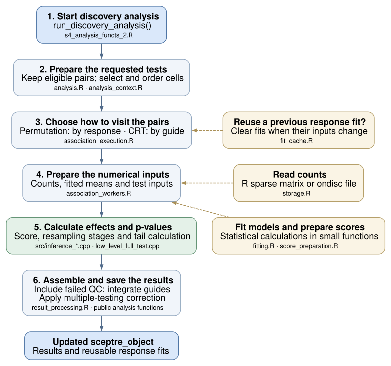
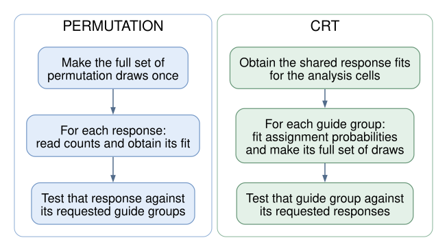

The aim is to make SCEPTRE easier to work on. The functions a user calls and the
saved `sceptre_object` stay the same. Inside the package, selecting cells,
reading counts, fitting models, running tests and assembling results now have
clearer homes.

**Suggested reading:** start with the module map, follow the example of one
test, then use the file map when you want to change something. The
[bug-by-bug notes](bug-fixes.html) are a separate appendix, with a concrete
example, fix and regression test for each item. Its [QMD source](bug-fixes.qmd)
is also versioned.

```{r}
#| label: setup
#| include: false
root <- normalizePath("../..", mustWork = TRUE)
stopifnot(file.exists(file.path(root, "R/analysis_context.R")))
show_function <- function(file, name) {
    expressions <- parse(file.path(root, file), keep.source = TRUE)
    refs <- attr(expressions, "srcref")
    hit <- which(vapply(expressions, function(x) {
        is.call(x) && identical(x[[1L]], as.name("<-")) &&
            identical(x[[2L]], as.name(name))
    }, logical(1)))
    stopifnot(length(hit) == 1L)
    lines <- readLines(file.path(root, file))
    span <- refs[[hit]]
    cat("```r\n", paste(lines[span[[1L]]:span[[3L]]], collapse = "\n"),
        "\n```\n", sep = "")
}
```

## The modules and how they talk to each other

Yes: the refactored package has **conceptual modules**. Here, a module means a
group of functions and files with a particular job. They all live in the same
R package and share its namespace. The separation comes from smaller functions
with explicit inputs and outputs; these are not separately installed packages.

{width=100%}

**How to read this map:** an arrow points from the part asking for work to the
part doing it. Its label reads **input → returned value**. For example,
execution asks count access for a gene in a particular set of cells and gets a
count vector back. The returned values travel back along the same connection;
there is no separate return arrow. These are the main calls, not every helper
call or their order in time. R filenames are under `R/`; C++ files are under
`src/`.

The boxes group closely related jobs to keep the map readable. Model fitting
and score preparation, for example, have separate files even though they share
a box. Pair QC and calibration-pair construction also have separate files;
they share the same eligibility rule so that calibration and discovery agree
about which pairs qualify.

### What actually passes between the modules?

- **Workflow and preparation** read the saved object and make temporary lists
  of requested pairs, settings and ordered cell selections. The workflow also
  tells fit reuse when changed inputs require old fits to be cleared, and saves
  completed fits after a successful run. Those state-update calls are omitted
  from the figure.
- **Execution** coordinates the calculations. It asks count access for data,
  reuses a valid response fit or asks the fitter for one, and asks score
  preparation for the numerical arrays the test needs. It also arranges
  resampling draws using the existing sampling helpers.
- **The numerical test** receives those arrays and draws and returns effect
  estimates, p-values and requested diagnostics. It does not select data from
  the saved object or start parallel workers.
- **Result processing** turns returned records into tables, keeps pair labels,
  adds failed-QC rows back and performs the final processing for that analysis. The public
  workflow saves the completed output in the returned object.

This is a map of the **refactored analysis core**. Importing data, assigning
guides and plotting remain in their own existing parts of the package. Some
workflow-facing helpers still read the S4 object; the numerical fitter, score
preparation and test have narrower inputs. The package is easier to work on
because, for example, changing a response fitter starts in `fitting.R`, while
changing count access starts in `storage.R`. Any resulting behavior change
still needs its own tests and review.

## A run through those modules: discovery

{width=100%}

Read the numbered boxes from top to bottom. The yellow boxes are supporting
jobs used along the way. Unlike the module map above, this picture follows the
order of work during a discovery run; it leaves out individual function calls.

Calibration and power use many of the same pieces, with their own requested
pairs and final processing. For example, power results are grouped without the
discovery analysis's multiple-testing correction. Nextflow also uses some of
these pieces directly; its nuclear shards are saved before global correction.

The practical change is that a function computing fitted means can now receive
a response vector and a design matrix. It does not need to know how counts
were stored, how workers were started, or where results will be saved.

## Follow one requested test

Suppose discovery requests a test of **guide group A against response gene R1**.

1. **Start from the existing object.** `run_discovery_analysis()` checks that
   prerequisite steps have run. It reads the settings and saves the completed
   results back into the returned object.
2. **Choose the pairs and cells.** `analysis.R` keeps pairs that passed QC.
   `analysis_context.R` works out which original count-matrix columns belong in
   each fit, and in what order. Counts and covariates must use that same order.
3. **Obtain the model fit.** The analysis reuses an earlier response fit only
   where it is still valid. Otherwise `fitting.R` fits the response model.
   `score_preparation.R` turns the fit into the arrays the current test needs.
4. **Run the test.** `association_workers.R` connects those inputs to the
   C++ function `run_association_test()`. The C++ files calculate the effect,
   score and p-value using the existing resampling method.
5. **Assemble the result table.** `result_processing.R` keeps requested pair
   labels, adds failed-QC rows back, and sorts by p-value and response gene,
   with missing p-values last. It also integrates guides and applies the
   complete-family correction. The public
   analysis function then saves the results and reusable response fits.

The saved object still holds the user's data and results. The temporary lists
used inside an analysis hold the selected cells, settings and prepared inputs.
They disappear when the run ends; they do not replace the saved-object format.

## Why permutation and CRT have different loops

The two methods can reuse different work. The diagram below shows the common
case using **complement controls**.

{width=100%}

For permutation, reading and preparing R1 once lets us test it against its
requested guide groups. For CRT, fitting A's assignment probabilities and
generating A's draws once lets us test A against its requested responses.
These loops live in `association_execution.R`; the calculations for the
individual tests live in `association_workers.R`.

**NT-control discovery is an important qualification.** Each guide group's
response fit uses that group's treatment cells plus the NT cells. Those fits
therefore remain specific to the group. Calibration with NT controls uses the
NT pool. The refactor keeps those statistical distinctions explicit.

## The indexing change, with five cells

A cell can have a different position in the original matrix, the cells retained
after QC, and the particular fit being run. Those are three position numbers
for the same cell.

Suppose QC retained original columns **2, 4, 5, 8, 11**. Group A's treatment cells
are original columns **4, 5**, and the NT pool is ordered **8, 2, 11**.
For NT-control discovery, the fitted data use treatment cells followed by NT
cells. The actual selection code gives:

```{r}
#| label: ordered-cell-view
context_code <- new.env(parent = baseenv())
sys.source(file.path(root, "R/analysis_context.R"), envir = context_code)
index <- list(
    analysis_to_source = c(2L, 4L, 5L, 8L, 11L),
    groups_analysis = list(A = c(2L, 3L)),
    nt_to_analysis = c(4L, 1L, 5L),
    calibration_check = FALSE,
    control_group_complement = FALSE
)
view <- context_code$make_fit_view(index, "A")
stopifnot(identical(view$source_cells, c(4L, 5L, 8L, 2L, 11L)),
          identical(view$trt_fit_pos, 1:2))
knitr::kable(data.frame(
    `Position in this fit` = seq_along(view$source_cells),
    `Original matrix column` = view$source_cells,
    `Position after QC` = view$fit_to_analysis,
    Role = c("Treatment", "Treatment", "NT", "NT", "NT"),
    check.names = FALSE
))
```

Both the response vector and the design matrix select original columns
**4, 5, 8, 2, 11**. The treatment cells are positions **1, 2** inside that fit.
That is why passing the original column numbers straight into a fitted test
would be wrong.

The new code constructs this ordered selection in one place and passes it to
both count-reading and model-fitting code. It avoids rediscovering the same
relationships in several functions. Inside R, positions start at 1. At the
R-to-C++ test entry, observed treatment positions are converted once to start
at 0. The synthetic draws already use that C++ convention.

<details>
<summary>Show the actual cell-selection function</summary>

This excerpt is read from `R/analysis_context.R` when the page is rendered.

```{r}
#| label: view-source
#| results: asis
show_function("R/analysis_context.R", "make_fit_view")
```

</details>

## Where would I make a change?

Use the question in the first column to choose a starting file. The last column
says what work that file actually does.

| I want to… | Start here | What I will find |
|---|---|---|
| Change the checks or state updates around a public analysis | `s4_analysis_functs_2.R`, `workflow_state.R` | Prerequisite checks and saving completed results/fits into the returned object |
| Understand which cells and pairs a test uses | `analysis_context.R`, `analysis.R` | Cell selections, cell order, pair identities and analysis settings |
| Change how counts are read from R matrices or ondisc | `storage.R` | Read a response, count selected cells, construct/reopen backed data |
| Change pairwise QC | `pair_qc.R`, `src/pair_eligibility.h` | Collect the measurements, then apply the current threshold rule; calibration uses that rule too |
| Change the response or assignment model fit | `fitting.R` | Response/design to coefficients and dispersion, or treatment/design to assignment probabilities |
| Change how the fitted response becomes test inputs | `score_preparation.R` | Fitted means and the current score arrays, in the selected cell order |
| Understand reuse of an earlier response fit | `fit_cache.R` | Which changes clear saved fits, and how new fits are saved |
| Change the order or sharing of association work | `association_execution.R`, `association_workers.R` | The response loop for permutation, guide loop for CRT, and their test calculations |
| Change process splitting, progress messages or logs | `execution.R` | Starting serial/parallel work and collecting its outputs |
| Change the numerical association test | `src/inference_*.cpp`, `src/low_level_full_test.cpp` | Effect/score calculations, tail approximation, resampling stages and the R entry function |
| Change output tables or guide integration | `result_processing.R` | Output columns, failed-QC rows, guide integration and family correction |

`ondisc` is a separate dependency. SCEPTRE's private ondisc calls are now grouped
in `storage.R`, which makes that dependency easier to inspect and change.
Importing data and assigning guides still begin in their familiar
`import_functs.R` and `assign_grna_functions.R` files.

### If you remember the old files

Much of the work previously spread across `medium_level_functs_v2.R` and
`association_testing_functions_v2.R` is now divided among the analysis,
execution and worker files above. Numerical response fitting and score
preparation previously grouped in `precomputation_functions.R` now live in
`fitting.R` and `score_preparation.R`. Result processing also has its own file.
The old large files were removed after their callers were updated.

### A small example of the new style

Inside the package, response fitting and score preparation can be read as two
separate steps:

```{r}
#| eval: false
#| echo: true
fit <- fit_response(expressions, covariate_matrix)
score <- prepare_score_components(expressions, covariate_matrix, fit)
```

The existing response fitter runs Poisson `glm.fit()` and then estimates and
clips dispersion. A future faster fitter has a specific place to start.
Changing the fitter would still require checking its statistical behavior and
whether old saved fits can be reused.

<details>
<summary>Show the actual response-fitting function</summary>

This excerpt comes directly from `R/fitting.R`.

```{r}
#| label: fitter-source
#| results: asis
show_function("R/fitting.R", "fit_response")
```

</details>

## Which bugs were fixed?

Some changes intentionally repair previously broken behavior. They are separate
from moving code into clearer files. For example:

- An unsorted list of genomic positions could make cis-pair construction miss
  an eligible gene.
- An accepted intercept-only formula could fail when using NT controls because
  R had dropped a matrix dimension.
- Asking for extra diagnostic output could make discovery plots omit valid
  results whose optional diagnostics were missing.
- A cached response fit could survive a change of control cells or design and
  then be reused for the wrong fit.

The [bug-by-bug appendix](bug-fixes.html) explains these and the import,
input-mutation, plotting, calibration-safety and memory-cleanup fixes. It also
identifies an avoidable dense-allocation improvement, the remaining limitations,
and the two accepted memory costs. Every fix points to its implementation and
regression test, so Tim can review a single item without reading an audit log.

## How this helps later extensions

The refactor gives future work a starting point; it does not implement those
extensions.

- **Faster GLM fitting:** start with `fitting.R` and then check score inputs and
  saved-fit reuse.
- **SPA or Wilcoxon:** start with the individual-test functions in
  `association_workers.R`. A method should prepare the inputs it needs.
- **New pairwise QC:** change the measurements and shared eligibility rule
  together, including how calibration candidates are accepted.
- **Bioconductor data or backed CRT:** start with count access in `storage.R`
  and inspect the relevant analysis loop. Backed CRT still needs its current
  validation restriction, I/O behavior and statistical/resource validation
  addressed before it can be enabled.
- **Nextflow:** keep the scripts' inputs, output tables and saved-object fields
  compatible. Apply the global correction after collecting the complete family,
  at the stage required by that pipeline.

The more detailed reference is [ARCHITECTURE.md](../../ARCHITECTURE.md).

## Testing: before and after

The original suite already checked imports, guide assignment, QC, calibration,
power, discovery, plots, a backed import and parallel execution. The refactor
keeps that foundation and adds focused tests for the smaller internal functions,
cell ordering, fit reuse, numerical calculations and the bugs described above.

### What changed in the numbers?

These measurements compare the original package (`21f9ea0`) with the refactored
package's **permanent tests** after the old/new comparison was separated out
(`2ec09e9`). Both ran in the same R/macOS/dependency environment.

| Measure | Before | After |
|---|---:|---:|
| Test blocks: named `test_that()` scenarios | 56 | 138 |
| Passing assertions inside those blocks | 2,578 | 4,199 |
| Executable R lines reached by the package tests | 3,336 / 4,722 | 4,097 / 4,868 |
| **R-line coverage** | **70.65%** | **84.16%** |

That is an increase of **13.51 percentage points** in measured R-line coverage.
The code and its executable-line count changed during the refactor.
A line is covered when a test executes it at least once. This is more informative
than counting tests alone: a loop can produce many assertions, and 2,225
assertions on each side check mock-data helpers. Neither count nor line coverage
shows that every branch, input or statistical result has been checked.

The table records a matched coverage measurement at the earlier post-separation
checkpoint, before the final handoff tests were strengthened. It is retained as
that measurement, not presented as a fresh coverage percentage for a later commit.
The final source-package check passes **4,397 assertions**, with no failures,
warnings or skips. Its receipt records the tested commit and package build.
The coverage percentage above remains the earlier matched measurement.

The handoff pass also adds checks of individual and joint sampling probabilities,
direct QC calculations from the input counts, meaningful result rows and pair
labels, expected warnings, older saved-object inputs and failed worker reporting.
A controlled check confirms that constant/biased samplers, correlated cells or repeated CRT draws,
p-values of 2 on these toy inputs, changed pair labels, missing rows and unexpected
warnings are rejected. Repeatability alone would miss several of these defects.

### What do the added tests cover?

| Area | Examples of checks now made directly |
|---|---|
| Cells and counts | Noncontiguous/reordered cells; matching counts and covariate rows; sparse/backed agreement; preserving the supplied matrix and indices |
| Fitting and test calculations | Response/assignment fits from explicit inputs; score and effect formulas; declared resampling stages and sampler properties |
| Reuse and execution | Reused versus freshly computed fits; clearing fits after control/design changes; serial versus two-worker results; saving and resuming a current object |
| Previously broken cases | Intercept-only NT fits, unsorted imports/cis positions, symmetric dense inputs and the individual plotting regressions in the [bug notes](bug-fixes.html) |

**C++ gets additional direct checks.** The package tests also call C++ through
the R functions. Routine CI adds direct mathematical checks and controlled
error tests: 9 draw-pointer cases, 214 count-buffer cases,
14 dispersion error-policy cases and 959 result-buffer cases. These deliberately
trigger small failures and check cleanup; they do not exhaust the machine's
memory. They give targeted evidence about the numerical and memory-handling
code, but we have **not measured a C++ line-coverage percentage**.

### Permanent correctness tests and the temporary old/new comparison

These answer different questions:

| Question | Where it is checked |
|---|---|
| Does the current package behave correctly? | Permanent `tests/testthat/` tests and checks of the current C++ code under `tools/checks/`; these run in CI |
| Does the refactor match the old implementation on the agreed cases? | The manual suite under `tools/refactor/consistency/`; this stays outside CI |

The unflagged manual comparison records **1,265 assertions in 31 blocks**.
The final handoff run explicitly requires backed coverage and passes **1,266**:
the additional assertion requires ondisc to be installed. It
checks old/new API and saved-object compatibility, scientific outputs, cell/pair
order and complete sampler streams. Some scenarios overlap the permanent suite,
so these counts should not be added as independent test cases. The earlier
4,740-assertion figure described the mixed suite before this separation; checks
were moved and current-behavior tests were expanded, rather than simply
partitioning that total.

From a committed checkout, run that comparison with:

```bash
Rscript --vanilla tools/refactor/compare.R /absolute/fresh/output
```

It builds the original and committed candidate separately, then compares the
installed candidate with verified original results. Read `comparison.json`
for the exact commits/outcome, and `checks.csv`/the logs for details.
Uncommitted changes are excluded. [The command guide](consistency/README.md)
explains dependencies, output files and platform-specific skips.

### What remains outside these numbers?

There is still untested R code, including much of the generic object display/
print/plot code in `s4_helpers.R` and some validation paths. Line coverage also
does not measure all branches or the space of possible datasets. The figures
above describe the package tests only; examples, vignettes, C++ source probes,
manual old/new checks and actual pipeline runs do not contribute to that R
percentage. Full package checks and the separate
[pipeline/Nextflow and resource qualification](https://github.com/Katsevich-Lab/sceptre/blob/refactor-evidence-2026-10-16-e1f8109/tools/refactor/FINAL_ACCEPTANCE.md) provide
additional evidence.

<details>
<summary>Measurement details and per-file results</summary>

The [coverage report](https://github.com/Katsevich-Lab/sceptre/blob/refactor-evidence-2026-10-16-e1f8109/tools/refactor/results/testing-coverage-2ec09e9/README.md) retains exact
source commits, source/test hashes, logs, test outcomes, coverage objects and
[per-file results](https://github.com/Katsevich-Lab/sceptre/blob/refactor-evidence-2026-10-16-e1f8109/tools/refactor/results/testing-coverage-2ec09e9/after-files.csv).
The paired measurement used covr 3.6.5 on R 4.6.0/macOS arm64, with the same
dependencies and guarded ondisc 1.3.5. It instrumented R functions only, excluded
generated Rcpp R wrappers using covr's standard rule, and left native compilation
at its ordinary flags. These are executable R-line percentages, not percentages
of all package source or a measure of scientific validity. Source and tests
were hash-checked before and after both runs. This one-off comparison is
build-excluded developer evidence, not a new CI job.

</details>

## A few words used in other notes

| Word | Meaning here |
|---|---|
| Cache | Previously computed response coefficients and dispersion, saved so they can be reused |
| View | The selected cells in a particular order; it does not mean copying the whole count matrix |
| Context | A temporary list of inputs and settings prepared for one analysis |
| Worker | An R function that performs one chunk of the analysis, in the current process or a separate process |
| Facade | The user-facing SCEPTRE functions and object that call the smaller internal functions |
| Backend | The way counts are stored and accessed, such as an R sparse matrix or ondisc |

The tour, figures, bug notes and comparison command stay in Git under
`tools/refactor/` for maintainer review. `.Rbuildignore` excludes them from the
R source package. Keep the root architecture guide and permanent tests later;
after review, preserve a tagged snapshot before retiring this temporary folder.
